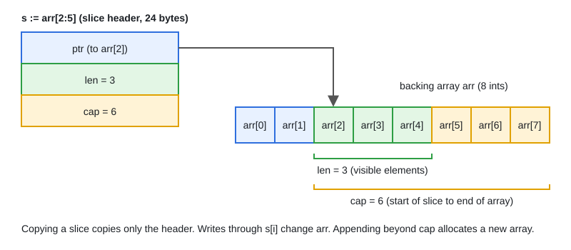

# 02 · Arrays & Slices Internals

[← Section index](../README.md) · Prev: [01 · Variables, Types, Constants & iota](../01-variables-types-constants-iota/README.md) · Next: [03 · Maps Internals](../03-maps-internals/README.md)

**Interview weight: 1.3%**  ·  Revise in: 8 min  ·  Run: `go run ./01-go-fundamentals/02-arrays-slices-internals`

## In one line
A slice is a small header (pointer, length, capacity) over a backing array, so copying a slice shares the data, and `append` only reallocates when capacity runs out.

## Must know
- Arrays are values: the length is part of the type and assignment copies every element.
- Slice header = `{ptr, len, cap}`. Passing a slice passes a copy of the header, elements are shared.
- `s[lo:hi]` makes no copy. `cap` runs from `lo` to the end of the backing array.
- `append` writes in place if `len < cap`, otherwise it allocates a bigger array and copies. Growth is about 2x for small slices, then slower (about 1.25x); exact numbers are not guaranteed.
- `s[lo:hi:max]` limits capacity, so a later `append` must copy instead of overwriting.
- nil slice and empty slice behave the same for `len`, `append`, `range`. JSON gives `null` vs `[]`.
- A small sub-slice keeps the whole backing array alive. Copy with `slices.Clone` or `copy`.
- `copy(dst, src)` copies `min(len(dst), len(src))` elements, so `dst` needs length, not just capacity.

## Diagram


## Code to remember
```go
base := make([]int, 3, 10)
x := append(base, 1)
y := append(base, 2) // same spare slot: x[3] is now 2 too

x = append(base[:3:3], 1) // capped: forces a new array
y = append(base[:3:3], 2) // independent
```

## Common traps
- Two appends from the same slice with spare capacity overwrite each other.
- `make([]int, n)` followed by `append` gives `n` zeros first. Use `make([]int, 0, n)`.
- Deleting inside a forward `range` loop skips elements. Use `slices.DeleteFunc` or filter in place.

## Interview Q&A

**Q1. What is a slice and what does copying it copy?**

**A:** A 3-word header: pointer, len, cap. Copying copies the header only, so both slices see the same elements.

**Q2. Why did my function append not change the caller slice?**

**A:** The function got a copy of the header. Return the slice and assign it: `s = add(s, v)`.

**Q3. How does `append` grow a slice?**

**A:** When `len == cap` it allocates a larger array (about double for small slices, then roughly 1.25x) and copies. Do not rely on exact capacities.

**Q4. nil slice vs empty slice?**

**A:** Both have len 0 and work with `append` and `range`. Only `== nil` and `json.Marshal` tell them apart. Check `len(s) == 0`.

**Q5. How can a slice leak memory?**

**A:** `small := big[:4]` keeps all of `big` reachable. Use `slices.Clone(big[:4])` to keep only what you need.

**Q6. What is the difference between an array and a slice?**

**A:** An array has a fixed length that is part of its type (`[3]int`) and is copied on assignment. A slice (`[]int`) is a resizable header over an array, and copying it shares the elements.
