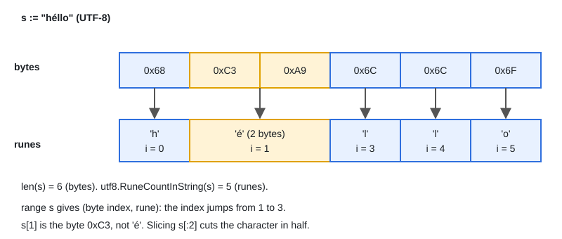

# 04 · Strings, Runes & Bytes

[← Section index](../README.md) · Prev: [03 · Maps Internals](../03-maps-internals/README.md) · Next: [05 · Structs, Methods & Embedding](../05-structs-methods-embedding/README.md)

**Interview weight: 0.9%**  ·  Revise in: 5 min  ·  Run: `go run ./01-go-fundamentals/04-strings-runes-bytes`

## In one line
A string is an immutable sequence of bytes (usually UTF-8), a `rune` is one Unicode code point (one character's number), and `len` counts bytes, not characters.

## Must know
- `string` is a read-only byte slice under the hood (pointer plus length). Assigning or passing it is cheap.
- `len(s)` and `s[i]` work on bytes. `for i, r := range s` decodes UTF-8 (see diagram). Count characters with `utf8.RuneCountInString(s)`.
- `rune` is an alias for `int32`, `byte` is an alias for `uint8`.
- Strings are immutable. To change one, convert to `[]byte` or `[]rune`, edit, convert back (each conversion copies).
- Slicing `s[a:b]` uses byte offsets and can cut a multi-byte character in half.
- Building in a loop with `+=` copies every time. Use `strings.Builder`.
- Strings are comparable with `==` and ordered by bytes, so they work as map keys.

## Diagram


## Code to remember
```go
func reverse(s string) string {
	r := []rune(s)
	for i, j := 0, len(r)-1; i < j; i, j = i+1, j-1 {
		r[i], r[j] = r[j], r[i]
	}
	return string(r)
}
```

## Common traps
- Reversing or indexing a string by byte and breaking non-ASCII text.
- Assuming the `range` index goes up by one per character.
- Concatenating with `+=` inside a loop (quadratic copying).
- Treating a `[]byte` to `string` conversion as free; it copies.

## Interview Q&A

**Q1. What is the difference between a byte, a rune and a string?**

**A:** A byte is 8 bits, a rune is a Unicode code point (1 to 4 bytes in UTF-8), a string is an immutable run of bytes.

**Q2. Why does `len("世界")` return 6?**

**A:** `len` counts bytes. Each of these characters takes 3 bytes in UTF-8.

**Q3. How do you reverse a string correctly?**

**A:** Convert to `[]rune`, swap from both ends, convert back. Reversing bytes corrupts multi-byte characters.

**Q4. How do you build a large string efficiently?**

**A:** `strings.Builder` (optionally `Grow(n)`), which appends into one buffer instead of allocating a new string each time.

**Q5. What does `range` over a string give you?**

**A:** Each rune and the byte index where it starts. Invalid UTF-8 yields `utf8.RuneError` (U+FFFD) for that byte.

**Q6. What does `string(65)` return?**

**A:** `"A"`, because an integer converts to the character with that code point (`go vet` warns). For the text `"65"` use `strconv.Itoa(65)`.
