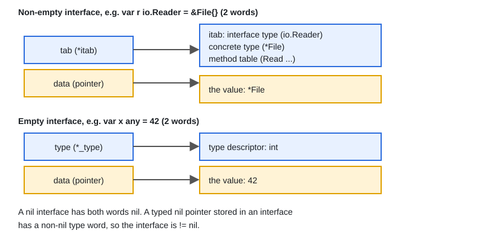

# 06 · Interfaces, Type Assertion & Type Switch

[← Section index](../README.md) · Prev: [05 · Structs, Methods & Embedding](../05-structs-methods-embedding/README.md) · Next: [07 · Pointers, Receivers & Addressability](../07-pointers-receivers-addressability/README.md)

**Interview weight: 1.3%**  ·  Revise in: 8 min  ·  Run: `go run ./01-go-fundamentals/06-interfaces-type-assertion-type-switch`

## In one line
An interface is a set of methods that any type satisfies implicitly, and an interface value holds a (type, value) pair, so it is only nil when both are nil.

## Must know
- Satisfaction is implicit: no `implements` keyword. Define small interfaces where they are used.
- "Accept interfaces, return structs." Keep interfaces to 1 to 3 methods (`io.Reader`, `error`, `fmt.Stringer`).
- An interface value is two words: a type (itab, a table of the type's methods, for non-empty interfaces) and a data pointer.
- A nil interface has both words nil. A typed nil pointer inside an interface is NOT `== nil`.
- Method sets: `T` has only value-receiver methods, `*T` has both. A pointer-receiver type must be stored as `&T{}`.
- `v, ok := x.(T)` is a safe type assertion. `x.(T)` without `ok` panics on mismatch.
- `switch v := x.(type)` branches on the dynamic type (the concrete type held inside). A `case` can be an interface type too.
- `any` is `interface{}`. Comparing interface values panics at runtime if the dynamic type is not comparable (for example a slice).

## Diagram


## Code to remember
```go
func describe(v any) string {
	switch x := v.(type) {
	case nil:
		return "nil"
	case int:
		return fmt.Sprintf("int %d", x)
	case error:
		return "error " + x.Error()
	default:
		return fmt.Sprintf("other %T", x)
	}
}
```

## Common traps
- Returning a typed nil pointer as `error`: `var e *MyErr; return e` makes `err != nil` true. Return a literal `nil`.
- Putting a `T` value in an interface when the methods have pointer receivers (compile error).
- Using `x.(T)` without `ok` on untrusted input.
- Defining a big interface on the producer side, which makes mocking and reuse hard.

## Interview Q&A

**Q1. How are interfaces implemented in Go?**

**A:** Implicitly. A type satisfies an interface by having its methods. The interface value stores the concrete type and a pointer to the data.

**Q2. Why is `err != nil` true when I returned a nil pointer?**

**A:** The interface holds a non-nil type (`*MyErr`) with a nil pointer. Only an interface with both parts nil equals `nil`. Return `nil` explicitly.

**Q3. Type assertion vs type switch?**

**A:** Assertion checks for one type (`v, ok := x.(T)`). A switch handles many types in one place. Both read the dynamic type.

**Q4. How do you check at compile time that a type implements an interface?**

**A:** `var _ Shape = (*Circle)(nil)`. It fails to compile if `*Circle` is missing a method.

**Q5. What does "accept interfaces, return structs" mean?**

**A:** Functions take the smallest interface they need so callers can pass anything, but return concrete types so callers keep all the methods.

**Q6. Can a `Circle` value satisfy an interface whose method has a pointer receiver?**

**A:** No. The method set of `T` has only value-receiver methods, while `*T` has both. Store `&Circle{}` in the interface.
