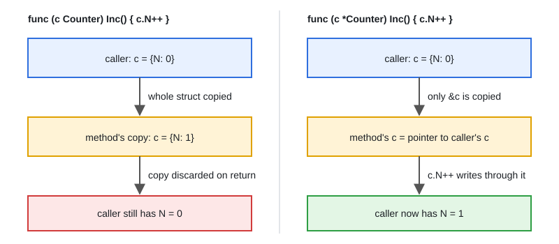

# 07 · Pointers, Receivers & Addressability

[← Section index](../README.md) · Prev: [06 · Interfaces, Type Assertion & Type Switch](../06-interfaces-type-assertion-type-switch/README.md) · Next: [08 · Functions, Closures & Defer](../08-functions-closures-defer/README.md)

**Interview weight: 1.2%**  ·  Revise in: 6 min  ·  Run: `go run ./01-go-fundamentals/07-pointers-receivers-addressability`

## In one line
Go passes everything by value, so use a pointer (or a pointer receiver) when you need to mutate the original or avoid copying a large struct.

## Must know
- `&x` takes an address, `*p` dereferences. `new(T)` returns a `*T` pointing at a zero value. No pointer arithmetic.
- Function arguments are always copies. Passing a pointer copies the pointer, not the data it points to.
- Value receiver works on a copy, pointer receiver mutates the original (see diagram). Use a pointer when the method mutates, the struct is large, or it holds a `sync.Mutex`. Do not mix both kinds on one type.
- Calling a pointer method on an addressable variable is rewritten by the compiler: `c.Inc()` becomes `(&c).Inc()`.
- Method sets: `T` has value-receiver methods only; `*T` has both. This decides interface satisfaction.
- Not addressable (you cannot write `&x`): map elements, return values, and constants. That is why `m[k].Inc()` fails for pointer methods.
- `range` gives a copy of each element. Modify through the index: `list[i].N++`.
- Go escape analysis decides stack or heap; returning `&local` is safe.

## Diagram


## Code to remember
```go
type Counter struct{ N int }

func (c Counter) IncValue()    { c.N++ } // copy, caller sees nothing
func (c *Counter) IncPointer() { c.N++ } // original is changed

for i := range list { // not: for _, item := range list
	list[i].N++
}
```

## Common traps
- Value receiver that "does nothing" because it mutates a copy.
- Storing `T` in an interface whose methods have pointer receivers (compile error, use `&T{}`).
- Taking `&item` of a range variable and storing it. Since Go 1.22 each iteration has its own variable, but older code and older Go versions share one.
- Nil pointer dereference: check for nil before using a pointer that may be unset.

## Interview Q&A

**Q1. Does Go pass by value or by reference?**

**A:** Always by value. Slices, maps and channels look like references because their value contains a pointer, but the header itself is copied.

**Q2. When do you use a pointer receiver?**

**A:** When the method mutates the receiver, when the struct is large, or when it contains a mutex. Keep all methods of a type consistent.

**Q3. Why can I not call a pointer method on a map element?**

**A:** Map elements are not addressable (they can move on growth). Copy out, modify, store back, or use `map[K]*V`.

**Q4. Why does `for _, v := range items { v.N++ }` not change the slice?**

**A:** `v` is a copy of each element. Write through the index: `items[i].N++`, or range over a slice of pointers.

**Q5. Is returning a pointer to a local variable safe?**

**A:** Yes. The compiler moves the variable to the heap when it escapes.

**Q6. What is the difference between `new` and `make`?**

**A:** `new(T)` returns a `*T` to a zero value of any type. `make` only works for slices, maps and channels and returns the ready-to-use value, not a pointer.
