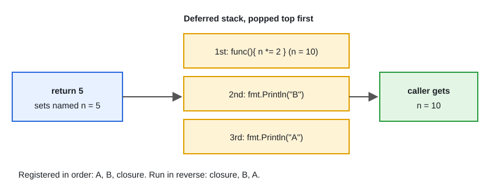

# 08 · Functions, Closures & Defer

[← Section index](../README.md) · Prev: [07 · Pointers, Receivers & Addressability](../07-pointers-receivers-addressability/README.md) · Next: [09 · Error Handling & Wrapping](../09-error-handling-wrapping/README.md)

**Interview weight: 1.3%**  ·  Revise in: 7 min  ·  Run: `go run ./01-go-fundamentals/08-functions-closures-defer`

## In one line
Functions are first-class values, closures capture variables (not copies), and `defer` runs at function exit in last-in-first-out order with its arguments evaluated immediately.

## Must know
- Multiple return values are idiomatic: `(value, error)`. Check `err` before using `value`.
- Variadic: `func sum(nums ...int)` receives a slice; call with `sum(s...)`.
- Functions are values: assign them, pass them, return them, put them in maps.
- A closure captures the variable itself, so every closure sees updates. A counter closure keeps its state after the outer function returns.
- Go 1.22+: each loop iteration has its own copy of the loop variable, so closures in loops capture per-iteration values.
- `defer` runs at return in LIFO order (see diagram). Arguments are evaluated at the `defer` line. Good for cleanup: `defer mu.Unlock()`.
- A deferred closure can change named results. This is how `recover` turns a panic into an `error`.
- `defer` in a long loop piles up until the function ends. Wrap the body in a function.

## Diagram


## Code to remember
```go
func counter() func() int {
	n := 0
	return func() int { n++; return n }
}

func safeDivide(a, b int) (result int, err error) {
	defer func() {
		if r := recover(); r != nil {
			err = fmt.Errorf("recovered: %v", r)
		}
	}()
	return a / b, nil
}
```

## Common traps
- `defer fmt.Println(x)` prints the value of `x` at the `defer` line, not at exit.
- `defer` inside a loop opening files: all stay open until the function returns.
- Ignoring the error from a deferred `Close()` on a file you wrote to.
- Named results plus bare `return` makes code hard to read. Use them mainly with `defer`.

## Interview Q&A

**Q1. In what order do deferred calls run, and when do they not run?**

**A:** Last in, first out, when the function returns, including on panic. They do not run if the program calls `os.Exit`.

**Q2. What does this print: `x := 1; defer fmt.Println(x); x = 2`?**

**A:** `1`. Deferred call arguments are evaluated when `defer` executes.

**Q3. What is a closure?**

**A:** A function value that captures variables from its surrounding scope. The captured variables live as long as the closure does.

**Q4. Did the loop variable closure bug change?**

**A:** Yes. Since Go 1.22 each iteration has its own variable, so `go func(){ use(i) }()` in a loop is safe. Older code passed `i` as an argument.

**Q5. How can a deferred function change the return value?**

**A:** Only with named results: `defer func(){ err = ... }()` modifies the variable that is returned.

**Q6. Why is `defer f.Close()` inside a loop a problem?**

**A:** Deferred calls run only when the function returns, so every file stays open until then. Move the loop body into its own function so each `defer` runs per iteration.
