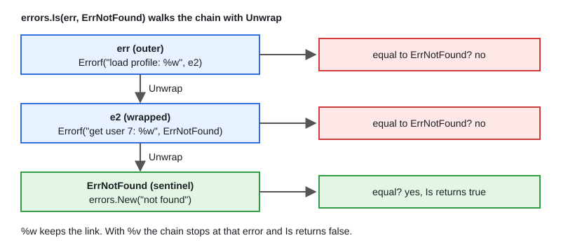

# 09 · Error Handling & Wrapping

[← Section index](../README.md) · Prev: [08 · Functions, Closures & Defer](../08-functions-closures-defer/README.md) · Next: [10 · Panic & Recover](../10-panic-recover/README.md)

**Interview weight: 1.3%**  ·  Revise in: 10 min  ·  Run: `go run ./01-go-fundamentals/09-error-handling-wrapping`

## In one line
Errors are values: wrap them with `%w` to add context, inspect them with `errors.Is` and `errors.As`, and handle each one once.

## Must know
- `error` is an interface with `Error() string`; a nil interface means no error.
- Sentinel (a fixed package-level value, `var ErrNotFound = errors.New(...)`) is checked with `errors.Is`.
- Custom type (`*ValidationError`) is checked with `errors.As` when the caller needs data.
- `fmt.Errorf("...: %w", err)` keeps the cause; `%v` throws it away.
- `errors.Is` and `errors.As` walk the whole wrap chain (see diagram); `==` does not.
- `errors.Join` (and several `%w`) build a tree; `errors.Unwrap` returns nil for it.
- Handle once: either log or return, never both. Log at the top (handler or main).
- At the boundary map errors to status codes in one `switch`; default to 500 and do not leak internals.

## Diagram


## Code to remember
```go
var ErrNotFound = errors.New("not found")

func get(id int) error {
	return fmt.Errorf("get user %d: %w", id, ErrNotFound)
}

err := get(7)
if errors.Is(err, ErrNotFound) { /* 404 */ }
var ve *ValidationError
if errors.As(err, &ve) { /* 400, use ve.Field */ }
```

## Common traps
- Typed nil: `var p *MyErr; return p` gives a non-nil `error`. Return a literal `nil`.
- Using `%v` instead of `%w`, so `errors.Is` silently stops working upstream.
- `err == io.EOF` style checks after someone wrapped the error. Use `errors.Is`.
- Log and return the same error: the same failure shows up many times in the logs.

## Interview Q&A

**Q1. How is `errors.Is` different from `==`?**

**A:** `==` compares one value. `errors.Is` walks the wrap chain and also calls a custom `Is` method if the error has one.

**Q2. Sentinel, custom type or opaque error?**

**A:** Sentinel when callers only branch on a known condition, type when they need data, opaque (just a message) when they cannot act. Every exported one is API you must keep.

**Q3. What is the typed-nil error trap?**

**A:** An interface is (type, value). A nil `*MyErr` stored in `error` has a type, so `err != nil` is true. Return `nil` explicitly.

**Q4. How do you collect errors from many goroutines?**

**A:** Buffered channel plus `WaitGroup`, then `errors.Join`. For first error plus cancel, use `errgroup` from `golang.org/x/sync` (not stdlib).

**Q5. When `%w` and when `%v`?**

**A:** `%w` when callers may inspect the cause; it becomes part of your API. `%v` to hide an internal detail, such as a database driver error.

**Q6. How does `errors.As` work?**

**A:** It walks the chain for the first error assignable to the target type and sets the target. Pass a pointer to that type (`&ve`, where `ve` is a `*ValidationError`); a non-pointer target panics.

**Q7. Where do you log an error and where do you wrap it?**

**A:** Wrap with context at each layer and return it. Log once at the top (handler or `main`), so one failure gives one log entry with the full chain.
