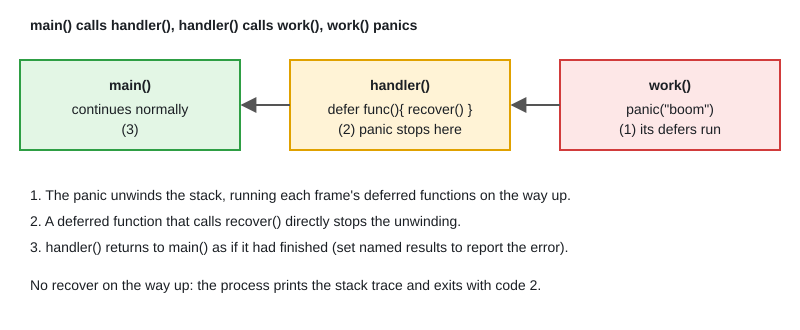

# 10 · Panic & Recover

[← Section index](../README.md) · Prev: [09 · Error Handling & Wrapping](../09-error-handling-wrapping/README.md) · Next: [11 · Generics](../11-generics/README.md)

**Interview weight: 1.0%**  ·  Revise in: 8 min  ·  Run: `go run ./01-go-fundamentals/10-panic-recover`

## In one line
A panic unwinds the stack running deferred functions; `recover` inside a deferred function stops it, and an unrecovered panic in any goroutine kills the whole process.

## Must know
- Use `error` for expected failures, `panic` for programmer bugs and impossible states.
- `recover()` only works when called directly by a deferred function, in the same goroutine, during a panic.
- After recovery the function returns normally; set named results to report the failure.
- A panic in a goroutine cannot be recovered by its parent. Each goroutine needs its own deferred function that calls `recover()`.
- Common runtime panics: nil map write, index out of range, nil pointer dereference, close of closed channel, divide by zero.
- `net/http` recovers handler panics and drops the connection; add a recovery middleware to return a 500 and log the stack.
- `log.Fatal` and `os.Exit` skip deferred functions; `panic` runs them.
- Since Go 1.21, `panic(nil)` becomes a `*runtime.PanicNilError`, so `recover` never returns nil during a panic.

## Diagram


## Code to remember
```go
func safeCall(f func()) (err error) {
	defer func() {
		if r := recover(); r != nil {
			err = fmt.Errorf("recovered: %v", r)
		}
	}()
	f()
	return nil
}
```

## Common traps
- Calling `recover()` in a helper that the deferred function calls: it returns nil.
- Expecting `recover` in `main` to protect goroutines started by `main`.
- Using panic for normal control flow or for bad user input in a library.
- Swallowing a panic you cannot handle; re-panic with `panic(r)` instead.

## Interview Q&A

**Q1. When is it fine to panic?**

**A:** Programmer errors and startup failures, for example `regexp.MustCompile` with a constant pattern. Never for input that comes from a caller or a request.

**Q2. Where does `recover` work?**

**A:** Only inside a deferred function, called directly by it, in the goroutine that panicked.

**Q3. What happens if a goroutine panics and nobody recovers?**

**A:** The whole program exits with code 2 and prints the stack trace. That is why worker pools wrap each job in a recover.

**Q4. How do you stop one bad HTTP request from crashing the service?**

**A:** The server already recovers per request, but a middleware with `defer recover()` lets you log `debug.Stack()` and send a 500.

**Q5. Can `recover` catch every runtime failure?**

**A:** No. Fatal errors such as concurrent map writes, deadlock (all goroutines asleep), out of memory and stack overflow kill the process.

**Q6. Do deferred functions run on `panic`, `os.Exit` and `log.Fatal`?**

**A:** On `panic`, yes, in LIFO order while unwinding. `os.Exit` and `log.Fatal` exit at once and skip every defer.
