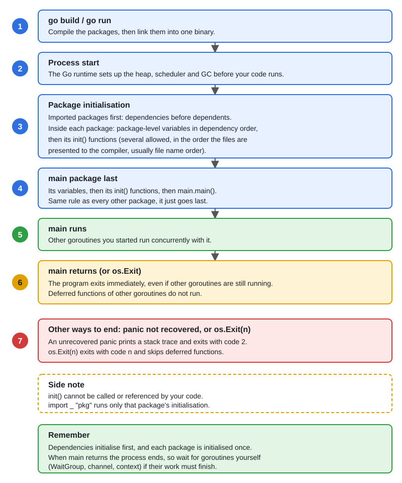

# 12 · Packages, Modules & Initialization Order

[← Section index](../README.md) · Prev: [11 · Generics](../11-generics/README.md) · Next: [13 · Testing, Benchmarks & Fuzzing](../13-testing-benchmarks-fuzzing/README.md)

**Interview weight: 0.7%**  ·  Revise in: 8 min  ·  Run: `go run ./01-go-fundamentals/12-packages-modules-init-order`

## In one line
Imported packages initialize first, then package-level variables in dependency order, then `init()` functions, then `main()`.

## Must know
- A module is a tree of packages with a `go.mod`; a package is one directory of `.go` files.
- Init order: imports (depth first), package variables (by dependency, then declaration order), `init()` functions, `main`.
- A package may have many `init()` functions, even in one file. They run in file order given to the compiler (sorted by file name), then source order.
- `init()` cannot be called or referenced. Use it sparingly: it hides side effects.
- Blank import `import _ "pkg"` runs a package's `init()` only, as `database/sql` drivers do.
- Exported means a capitalised name. An `internal/` directory can only be imported from its parent tree.
- `go.mod` holds the module path, Go version and requirements; `go.sum` holds checksums. `go mod tidy` syncs them.
- Import cycles are a compile error. Fix them by moving shared types or introducing an interface.

## End-to-end


## Code to remember
```go
var a = f("a", b) // depends on b, so b is initialized first
var b = f("b", 0)

func init() { fmt.Println("init 1") }
func init() { fmt.Println("init 2") } // legal: runs after init 1

// Set a string var at link time:
//   go build -ldflags "-X main.version=1.2.3"
var version = "dev"
```

## Common traps
- Relying on the order of `init()` across packages or files: keep them independent.
- Heavy work or network calls in `init()`: it makes tests and startup fragile.
- Putting everything in one package, or one package per type: split by responsibility.
- `-X` only sets package-level string variables, not constants.

## Interview Q&A

**Q1. In what order does a Go program initialize?**

**A:** Imported packages first, then package-level variables in dependency order, then `init()` functions, then `main`. Each package runs once.

**Q2. Why would you use a blank import?**

**A:** To run a package's `init()` for registration, for example a database driver or an image decoder.

**Q3. What does `internal/` do?**

**A:** The compiler only lets packages under the parent of `internal/` import it. It keeps implementation details private.

**Q4. What is the difference between `go.mod` and `go.sum`?**

**A:** `go.mod` declares the module and its dependencies. `go.sum` stores hashes to verify downloaded modules.

**Q5. How does Go pick dependency versions?**

**A:** Minimal version selection: the highest version any module in the build requires, not the latest published. Upgrade explicitly with `go get`.
