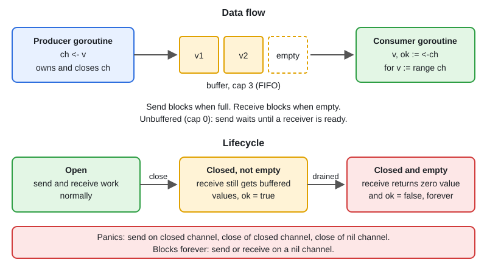

# Channels: Unbuffered, Buffered, Closing

[← Section index](../README.md) · Prev: [Goroutines Basics](../01-goroutines-basics/README.md) · Next: [select: Timeouts, Default, Event Loops](../03-select-timeouts-default/README.md)

**Interview weight: 1.4%**  ·  Revise in: 8 min  ·  Run: `go run ./02-concurrency/02-channels-unbuffered-buffered-closing`

## In one line
A channel is a typed, thread-safe queue that passes values between goroutines and synchronizes them.

## Must know
- Unbuffered: a send completes only when a receiver takes the value (handoff). Buffered `make(chan T, n)`: send blocks only when full.
- Receive from a closed channel returns the remaining buffered values first, then the zero value with `ok == false`.
- `close` wakes all blocked receivers, so `close(done)` works as a broadcast to all.
- Panics: send on a closed channel, close of a closed channel, close of a nil channel.
- Send or receive on a nil channel blocks forever. In `select`, setting a channel to nil disables that case.
- Only the sender side closes, and only when it is the single owner. Receivers never close.
- Use `chan<- T` and `<-chan T` in signatures to document ownership. `for v := range ch` stops on close.
- Closing is optional for GC. Close only to tell receivers "no more values".

## Diagram


## Code to remember
```go
func produce(n int) <-chan int {
    out := make(chan int)
    go func() {
        defer close(out) // producer owns and closes
        for i := range n {
            out <- i
        }
    }()
    return out
}

for v := range produce(5) { fmt.Println(v) }
```

## Common traps
- Sender blocked forever because the receiver timed out and left. Fix: buffer of 1, or a `ctx.Done()` case in the send.
- Closing from the receiver side, or from several senders: "close of closed channel" panic.
- Using `len(ch)` to make decisions. It is stale the moment you read it.
- Ranging over a channel that nobody closes: the loop (and goroutine) never ends.

## Interview Q&A

**Q1. Unbuffered vs buffered channel?**

**A:** Unbuffered synchronizes sender and receiver at the moment of transfer. Buffered decouples them up to `cap` items, then blocks like unbuffered. Buffer size is a tuning knob, not a fix for deadlocks.

**Q2. What happens on send/receive/close for nil and closed channels?**

**A:** Nil: send and receive block forever, close panics. Closed: send panics, receive returns zero value with ok false, close panics.

**Q3. Who should close a channel?**

**A:** The sender, when it is the only one. With several senders, coordinate with a WaitGroup and close once after all are done, or use a separate done channel and never close the data channel.

**Q4. How do you tell "closed" from "received a zero value"?**

**A:** Use `v, ok := <-ch`. `ok` is false only when the channel is closed and its buffer is empty.

**Q5. Channels or mutex?**

**A:** Channels to pass ownership of data or coordinate work. Mutex to protect shared state such as a map or counter.
