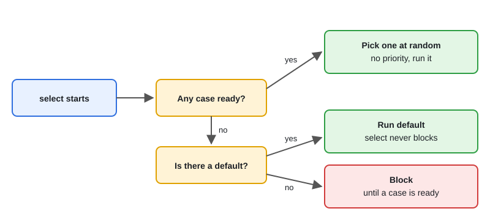

# select: Timeouts, Default, Event Loops

[← Section index](../README.md) · Prev: [Channels: Unbuffered, Buffered, Closing](../02-channels-unbuffered-buffered-closing/README.md) · Next: [sync.Mutex and sync.RWMutex](../04-sync-mutex-rwmutex/README.md)

**Interview weight: 1.2%**  ·  Revise in: 6 min  ·  Run: `go run ./02-concurrency/03-select-timeouts-default`

## In one line
`select` waits on several channel operations at once and runs the one that is ready, which is how Go does timeouts, cancellation and non-blocking operations.

## Must know
- Ready cases: one is picked at random, no priority. `default` makes `select` non-blocking: try a send or receive, else skip or drop.
- Timeout: `case <-time.After(d)` or, better in services, `case <-ctx.Done()`.
- A bare `break` inside `select` only leaves the select. Use a label or `return` to leave the `for`.
- A nil channel is never ready, so assigning `nil` disables a case (used when merging channels).
- `select {}` blocks forever (a deadlock if no other goroutine can run).
- Go 1.23+: an unreferenced `time.After` timer is garbage collected, so it no longer leaks in loops.
- `default` inside a tight `for` loop spins the CPU. Block instead.

## Diagram


## Code to remember
```go
for {
    select {
    case job := <-jobs:
        process(job)
    case <-ctx.Done():
        return ctx.Err()
    case <-time.After(5 * time.Second):
        return errors.New("idle timeout")
    }
}
```

## Common traps
- `break` in a select inside a for loop, expecting it to exit the loop.
- `select` with `default` in a busy loop: 100% CPU doing nothing.
- Timeout without a buffered result channel: the worker blocks forever on send after the caller gave up (leak).
- Expecting priority between ready cases. To prefer one, check it first with a non-blocking select.

## Interview Q&A

**Q1. What if multiple cases are ready?**

**A:** The runtime picks one uniformly at random, so no case can starve the others.

**Q2. How do you implement a timeout for a channel receive?**

**A:** `select` on the result channel and `time.After(d)` (or `ctx.Done()`). Make the result channel buffered with size 1 so the worker can finish and exit if nobody listens.

**Q3. How do you do a non-blocking send?**

**A:** `select { case ch <- v: default: }`. If the channel is full, the default branch runs, so you can drop or log.

**Q4. Why use a nil channel in select?**

**A:** A nil channel blocks forever, so the case never fires. Setting a closed input to nil lets you keep selecting on the remaining inputs until all are done.

**Q5. How do you exit a for-select loop?**

**A:** `return`, or `break` with a label on the for statement.
