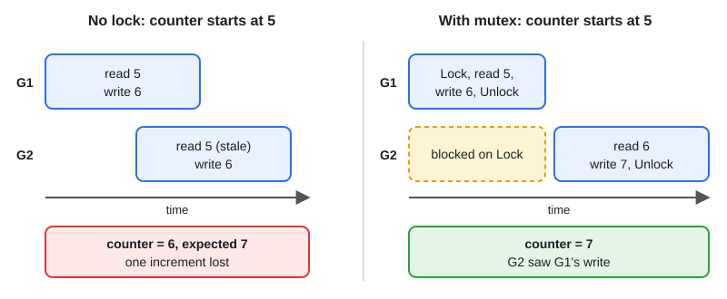

# sync.Mutex and sync.RWMutex

[← Section index](../README.md) · Prev: [select: Timeouts, Default, Event Loops](../03-select-timeouts-default/README.md) · Next: [sync.WaitGroup and sync.Once](../05-sync-waitgroup-once/README.md)

**Interview weight: 1.3%**  ·  Revise in: 7 min  ·  Run: `go run ./02-concurrency/04-sync-mutex-rwmutex`

## In one line
A mutex lets one goroutine at a time touch shared state; an RWMutex lets many readers in at once but only one writer.

## Must know
- Pattern: `mu.Lock(); defer mu.Unlock()`. Keep `mu` next to the fields it guards and comment what it guards.
- Never copy a Mutex after first use. Use pointer receivers. `go vet` (copylocks) catches this.
- Go mutexes are not reentrant: locking twice in the same goroutine deadlocks.
- `RWMutex`: `RLock`/`RUnlock` for readers, `Lock`/`Unlock` for writers. Worth it only when reads dominate and the critical section is not tiny.
- Do not upgrade `RLock` to `Lock` while holding it (deadlock). Do not take `RLock` recursively: a waiting writer blocks new readers, so it can deadlock.
- Keep critical sections (code between Lock and Unlock) short. Do not hold a lock across network calls, disk I/O or channel sends.
- Avoid lock-order deadlock: always acquire multiple locks in the same global order.
- Detect races with `go test -race` or `go run -race`.

## Diagram


## Code to remember
```go
type Counter struct {
    mu sync.Mutex // guards n
    n  int
}

func (c *Counter) Inc() {
    c.mu.Lock()
    defer c.mu.Unlock()
    c.n++
}
```

## Common traps
- Passing a struct containing a Mutex by value (copies the lock state).
- Returning a map or slice protected by the lock, then using it outside the lock. Return a copy.
- Forgetting `Unlock` on an early return. `defer` fixes this.
- Using RWMutex by default. For short critical sections a plain Mutex is often as fast or faster.

## Interview Q&A

**Q1. Is `sync.Mutex` reentrant? What if you lock twice in one goroutine?**

**A:** No. The second `Lock` blocks forever (deadlock). Lock once in the public method and keep helpers lock-free, documented as "caller holds mu".

**Q2. When is RWMutex better than Mutex?**

**A:** Many concurrent readers, few writers, and a read section long enough to benefit. Otherwise its extra bookkeeping cost can make it slower.

**Q3. How do you avoid deadlocks with several locks?**

**A:** Fixed lock order (for example by id), keep lock scope small, never call unknown callbacks while holding a lock, and never hold a lock while blocking on a channel.

**Q4. Can many goroutines use a plain map? Can `recover` catch the crash?**

**A:** No. Concurrent write, or read plus write, causes a fatal error that `recover` cannot catch. Guard it with a Mutex/RWMutex, or use `sync.Map` for the special cases.

**Q5. What does a data race look like?**

**A:** Two goroutines access the same variable, at least one writes, with no synchronization (diagram: both read 5, both write 6, one increment lost). `-race` reports it.

**Q6. What happens if you copy a `sync.Mutex`?**

**A:** The copy carries the current lock state, so it can start locked or protect nothing shared. Use pointer receivers and pass `*T`. `go vet` (copylocks) flags it.
