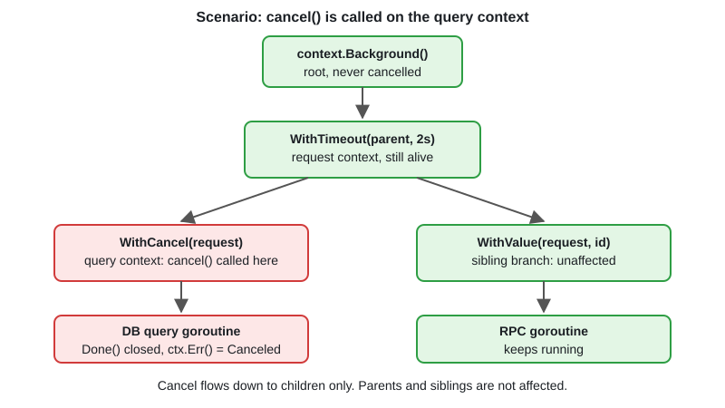

# Context: Cancellation, Timeouts, Values

[← Section index](../README.md) · Prev: [sync/atomic](../07-atomic-operations/README.md) · Next: [Worker Pool](../09-worker-pool/README.md)

**Interview weight: 1.3%**  ·  Revise in: 8 min  ·  Run: `go run ./02-concurrency/08-context-cancellation-timeouts-values`

## In one line
`context.Context` carries cancellation, a deadline and per-request values down a call tree so every goroutine and I/O call can stop when the request is done.

## Must know
- Roots: `context.Background()` (main, init, tests) and `context.TODO()` (placeholder).
- Derive: `WithCancel`, `WithTimeout`, `WithDeadline`, `WithValue`. Always `defer cancel()` to release resources (`go vet` checks this).
- Cancelling a context cancels all its children, never its parent.
- Check `<-ctx.Done()` in `select` and read `ctx.Err()`: `context.Canceled` or `context.DeadlineExceeded`.
- Cancellation is cooperative. Nothing kills a goroutine, your loop must check `ctx`.
- `ctx` is the first parameter, named `ctx`. Do not store it in a struct and do not pass nil.
- `WithValue`: only request-scoped data (request id, auth principal), with an unexported key type. Not for optional params or dependencies.
- `net/http`: `r.Context()` is cancelled when the client disconnects. `http.NewRequestWithContext`, `db.QueryContext` honour ctx.
- Go 1.20+ `WithCancelCause` and `context.Cause(ctx)`. Go 1.21+ `WithoutCancel`, `AfterFunc`.

## Diagram


## Code to remember
```go
ctx, cancel := context.WithTimeout(ctx, 2*time.Second)
defer cancel()

select {
case res := <-doWork(ctx):
    return res, nil
case <-ctx.Done():
    return nil, ctx.Err()
}
```

## Common traps
- Forgetting `cancel()`: the timer and child stay registered until the parent ends.
- Ignoring ctx inside loops and blocking calls, so cancellation never takes effect.
- Using `WithValue` as a hidden argument bag or with string keys.
- Using `context.Background()` inside a handler instead of `r.Context()`: client disconnects are not noticed.

## Interview Q&A

**Q1. What is context used for?**

**A:** Propagating cancellation, deadlines and per-request values across goroutines and API boundaries. Cancel only closes `Done()`, so code must watch it to stop.

**Q2. Canceled vs DeadlineExceeded?**

**A:** `Canceled` means someone called cancel (or the parent was cancelled). `DeadlineExceeded` means the timeout or deadline passed. Check with `errors.Is`.

**Q3. How do you put a timeout on an HTTP call or DB query?**

**A:** `ctx, cancel := context.WithTimeout(parent, d)`, `defer cancel()`, then `http.NewRequestWithContext(ctx, ...)` or `db.QueryContext(ctx, ...)`. On expiry the error wraps `DeadlineExceeded`.

**Q4. What if the parent has a 1s deadline and the child asks for 5s?**

**A:** The child gets the earlier one, so about 1s. A child can only shorten a deadline, never extend it.

**Q5. Should you put a logger or DB handle in context values?**

**A:** No. Pass dependencies explicitly. Values are for request-scoped data crossing API boundaries, such as trace id.

**Q6. Why `defer cancel()` even when `WithTimeout` expires by itself?**

**A:** If the work finishes early, `cancel` releases the timer and the link to the parent right away. Without it they live until the deadline or until the parent ends.
