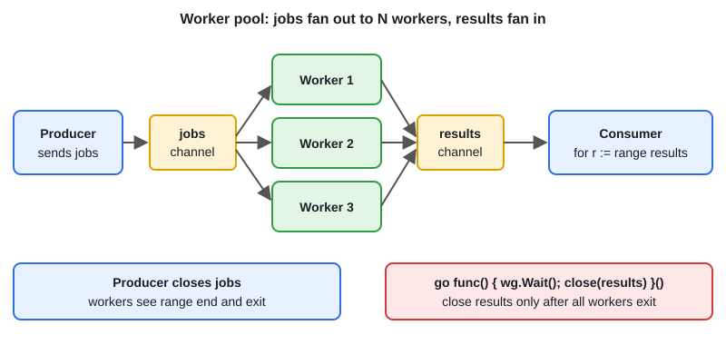

# Worker Pool

[← Section index](../README.md) · Prev: [Context: Cancellation, Timeouts, Values](../08-context-cancellation-timeouts-values/README.md) · Next: [Pipeline, Fan-out & Fan-in](../10-pipeline-fan-out-fan-in/README.md)

**Interview weight: 1.3%**  ·  Revise in: 8 min  ·  Run: `go run ./02-concurrency/09-worker-pool`

## In one line
A worker pool is N goroutines reading jobs from one channel, so concurrency stays bounded no matter how many jobs arrive.

## Must know
- Shape: producer -> `jobs` chan -> N workers -> `results` chan -> consumer
- The producer owns `jobs` and closes it; workers stop when their `range` ends
- Close `results` only after every worker exits: `go func() { wg.Wait(); close(results) }()`
- Call `wg.Add(1)` before `go`, in the spawning goroutine (or use `wg.Go` in Go 1.25)
- Unbuffered `jobs` gives backpressure (a fast producer is slowed to worker speed): it blocks until a worker is free
- Pool size: CPU-bound is about `GOMAXPROCS`; I/O-bound, measure and tune
- To keep input order, send `{index, payload}` and write `out[index]`
- To stop early, select on `ctx.Done()` in both producer and workers

## Diagram


## Code to remember
```go
jobs, results := make(chan int), make(chan int)
var wg sync.WaitGroup
for range n {
	wg.Add(1)
	go func() {
		defer wg.Done()
		for j := range jobs { results <- work(j) }
	}()
}
go func() { defer close(jobs); for _, j := range in { jobs <- j } }()
go func() { wg.Wait(); close(results) }()
for r := range results { use(r) }
```

## Common traps
- Closing `results` before the workers finish: a late send panics
- `wg.Wait()` in main before draining `results`: workers block on send, all goroutines asleep, deadlock
- Workers that never see `ctx.Done()` leak when the producer gives up
- Unbounded `go f(job)` per job instead of a fixed pool: memory and downstream overload

## Interview Q&A

**Q1. Why close `results` in a separate goroutine after `wg.Wait()`?**

**A:** The consumer must range over `results` at the same time, so main cannot block on `Wait()`. The helper goroutine waits for all workers, then closes, so no worker can send on a closed channel.

**Q2. How do you preserve input order?**

**A:** Carry the index with each job and result, and write into a pre-sized slice `out[index]`. Each index is written once, so no lock is needed.

**Q3. How do you stop a pool early or on error?**

**A:** Pass a `context`. The producer and each worker `select` on `ctx.Done()` next to the channel operation, then return.

**Q4. How many workers should you start?**

**A:** CPU-bound work: about the number of cores. I/O-bound work: more, found by measuring against the downstream limit. It is a tunable, not a constant.

**Q5. How do you handle errors from workers?**

**A:** Put an `err` field in the result struct and let the consumer decide. To cancel everything on the first error, use errgroup (topic 11).

**Q6. Should the `jobs` channel be buffered?**

**A:** Unbuffered gives backpressure: the producer waits for a free worker. A small buffer smooths bursts, but a large one hides overload and those queued jobs are lost if the process dies.
