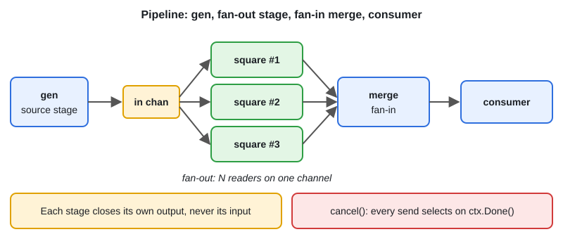

# Pipeline, Fan-out & Fan-in

[← Section index](../README.md) · Prev: [Worker Pool](../09-worker-pool/README.md) · Next: [errgroup, Semaphore & Bounded Concurrency](../11-errgroup-semaphore-bounded-concurrency/README.md)

**Interview weight: 1.1%**  ·  Revise in: 7 min  ·  Run: `go run ./02-concurrency/10-pipeline-fan-out-fan-in`

## In one line
A pipeline is stages connected by channels; fan-out runs several copies of a slow stage, and fan-in merges their outputs back into one channel.

## Must know
- A stage takes `<-chan T` in, returns `<-chan U` out, and runs its loop in a goroutine
- Each stage owns and closes its output channel; it never closes its input
- Fan-out: N goroutines `range` over the same input channel
- Fan-in (merge): one forwarder per input, `WaitGroup`, then close the output
- Fan-in order is not deterministic; sort or carry an index if order matters
- Every send is `select { case out <- v: case <-ctx.Done(): return }`, or a stage leaks when the consumer stops early
- Use directional channel types (`<-chan`, `chan<-`) so the compiler enforces ownership

## Diagram


## Code to remember
```go
func merge(ctx context.Context, ins ...<-chan int) <-chan int {
	out := make(chan int)
	var wg sync.WaitGroup
	for _, in := range ins {
		wg.Add(1)
		go func() {
			defer wg.Done()
			for v := range in {
				select { case out <- v: case <-ctx.Done(): return }
			}
		}()
	}
	go func() { wg.Wait(); close(out) }()
	return out
}
```

## Common traps
- Receiver closing a channel the sender still writes to: panic
- Stage that does a bare `out <- v` with no `ctx.Done()` case: goroutine leak on early exit
- Closing the merged output without waiting for all forwarders: lost values or panic
- Assuming fan-in keeps the input order

## Interview Q&A

**Q1. Who closes a channel in a pipeline?**

**A:** The sender, which is the stage that writes to it. Receivers just `range` and stop when it closes.

**Q2. How do you fan-in N channels into one?**

**A:** Start one goroutine per input that forwards to a shared output, count them with a `WaitGroup`, and close the output once all have finished.

**Q3. How do you stop a pipeline after the first few results?**

**A:** Cancel a shared `context`. Every stage selects on `ctx.Done()`, so goroutines blocked on a send return instead of leaking.

**Q4. Pipeline versus worker pool?**

**A:** A pool runs the same step in parallel. A pipeline splits different steps into stages, and a slow stage can use fan-out to run as a small pool.

**Q5. How do you merge two channels with a plain `select` loop?**

**A:** Loop while either is non-nil and `select` on both with `v, ok := <-a`. When `!ok`, set that channel to `nil`: a nil channel blocks forever, so it drops out of the `select`.
