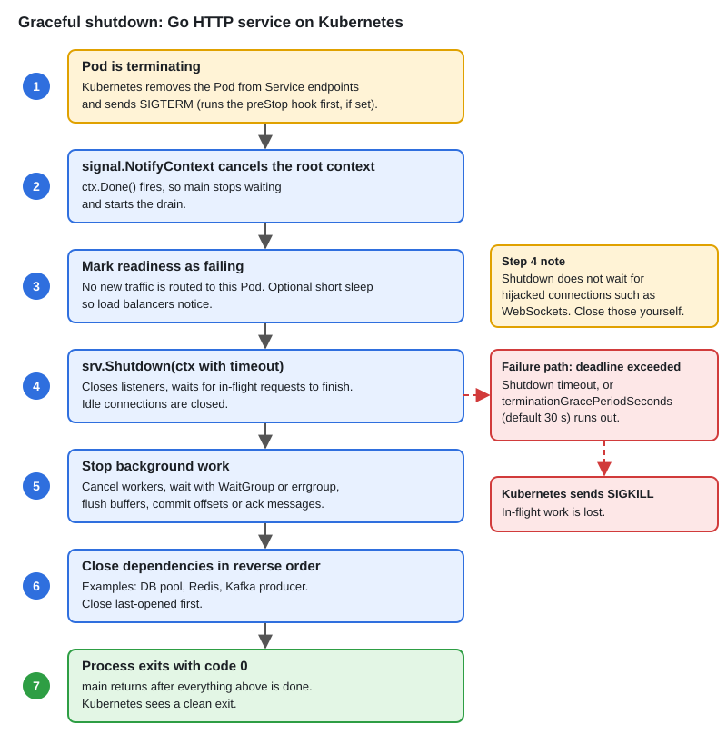

# Graceful Shutdown (HTTP Server)

[← Section index](../README.md) · Prev: [errgroup, Semaphore & Bounded Concurrency](../11-errgroup-semaphore-bounded-concurrency/README.md) · Next: [Rate Limiter — Token Bucket](../13-rate-limiter-token-bucket/README.md)

**Interview weight: 1.0%**  ·  Revise in: 6 min  ·  Run: `go run ./02-concurrency/12-graceful-shutdown-http-server`

## In one line
On SIGTERM (the OS's polite stop signal), stop accepting new requests, let in-flight ones drain (finish) within a deadline with `srv.Shutdown(ctx)`, stop background workers, then exit.

## Must know
- `signal.NotifyContext(ctx, os.Interrupt, syscall.SIGTERM)` returns a ctx cancelled on the signal
- `ListenAndServe` returns `http.ErrServerClosed` right after `Shutdown` is called; that is not a failure
- `Shutdown(ctx)` closes listeners, waits for active requests, and returns early with an error if ctx expires
- `Close()` drops connections immediately; use it only as a fallback after a timeout
- Always give shutdown a deadline so one hung handler cannot block exit
- Pass the same root ctx to background workers and wait for them with a `WaitGroup`
- Kubernetes sends SIGTERM, then SIGKILL after `terminationGracePeriodSeconds` (default 30s); keep your drain below that
- `Shutdown` does not wait for hijacked connections such as WebSockets; close those yourself

## End-to-end


## Code to remember
```go
ctx, stop := signal.NotifyContext(context.Background(), os.Interrupt, syscall.SIGTERM)
defer stop()

go func() {
	if err := srv.ListenAndServe(); !errors.Is(err, http.ErrServerClosed) {
		log.Fatal(err)
	}
}()

<-ctx.Done() // signal received
shutCtx, cancel := context.WithTimeout(context.Background(), 10*time.Second)
defer cancel()
if err := srv.Shutdown(shutCtx); err != nil { srv.Close() }
```

## Common traps
- Treating `http.ErrServerClosed` from `ListenAndServe` as a fatal error
- Using the already cancelled signal ctx for `Shutdown`, so it gives up immediately
- Exiting `main` before background goroutines and the DB or consumer are closed
- Calling `os.Exit` or `log.Fatal` in a goroutine, which skips deferred cleanup

## Interview Q&A

**Q1. `Shutdown` versus `Close`?**

**A:** `Shutdown` is graceful: no new connections, active requests finish. `Close` closes everything now and can cut requests mid-flight.

**Q2. How do you stop background goroutines on shutdown?**

**A:** Give them a context derived from the signal ctx, have them select on `ctx.Done()`, and `wg.Wait()` for them with a timeout.

**Q3. Why a shutdown timeout?**

**A:** A stuck request would block exit forever. The timeout bounds the drain, and the orchestrator will SIGKILL after its grace period anyway.

**Q4. What is a sensible shutdown order?**

**A:** Stop taking traffic (readiness probe fails, `Shutdown`), finish in-flight work, stop consumers and workers, then close dependencies like the DB.

**Q5. Does `Shutdown` cancel the context of in-flight requests?**

**A:** No. It waits for them to finish. To make handlers stop on shutdown, derive their context from the root ctx with `http.Server.BaseContext`.
