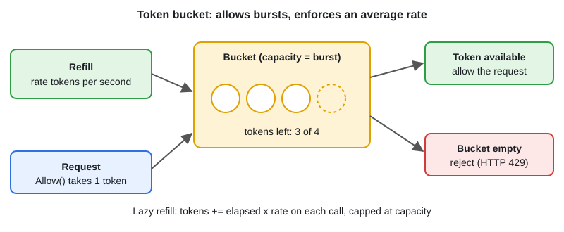

# Rate Limiter — Token Bucket

[← Section index](../README.md) · Prev: [Graceful Shutdown (HTTP Server)](../12-graceful-shutdown-http-server/README.md) · Next: [Race Conditions, Deadlocks & Detection](../14-race-conditions-deadlocks-detection/README.md)

**Interview weight: 0.9%**  ·  Revise in: 6 min  ·  Run: `go run ./02-concurrency/13-rate-limiter-token-bucket`

## In one line
A token bucket refills at a fixed rate up to a capacity and each request spends one token, so it allows short bursts while holding a steady average rate.

## Must know
- Two knobs: rate (tokens per second) and burst (bucket capacity)
- Lazy refill: on each call, `tokens = min(cap, tokens + elapsed*rate)`; no background goroutine needed
- Needs a mutex (or atomics) because many goroutines call `Allow` at once
- `golang.org/x/time/rate` is the usual production choice: `Allow()`, `Wait(ctx)`, `Reserve()`. It is not stdlib
- Per-client limits: one bucket per key in a map, and evict (delete) idle keys or memory grows forever
- Reject with HTTP 429 and a `Retry-After` header
- Inject the clock (`now func() time.Time`) so tests do not sleep
- Several app instances need shared state, usually Redis

## Diagram


## Code to remember
```go
func (b *Bucket) Allow() bool {
	b.mu.Lock()
	defer b.mu.Unlock()
	now := time.Now()
	b.tokens = min(b.capacity, b.tokens+now.Sub(b.last).Seconds()*b.rate)
	b.last = now
	if b.tokens < 1 {
		return false
	}
	b.tokens--
	return true
}
```

## Common traps
- Refilling with a ticker goroutine per limiter: wasteful, and it leaks if never stopped
- One global limiter when you need one per user or IP
- Forgetting to evict idle keys from the per-key map
- A fixed-window counter lets 2x the limit through around a window boundary

## Interview Q&A

**Q1. Token bucket versus leaky bucket?**

**A:** Token bucket allows bursts up to capacity. Leaky bucket drains at a constant rate, so output is smooth regardless of input bursts.

**Q2. Token bucket versus fixed or sliding window?**

**A:** Fixed window is simplest but can pass double the limit at the boundary. Sliding window is more accurate but costs more memory. Token bucket is cheap (two numbers per key) and burst friendly.

**Q3. How do you rate limit across several instances?**

**A:** Keep the counter in shared storage such as Redis, and make check-and-update atomic, for example with a Lua script. Or accept per-instance limits as an approximation.

**Q4. How does `rate.Limiter` avoid a refill goroutine?**

**A:** It stores the last update time and computes the tokens accrued from elapsed time on each call, the same lazy refill as above.

**Q5. `Allow`, `Wait` and `Reserve` on `rate.Limiter`?**

**A:** `Allow` answers true or false now (reject with 429). `Wait(ctx)` blocks until a token is free or ctx ends. `Reserve` returns how long to wait, so you decide.
