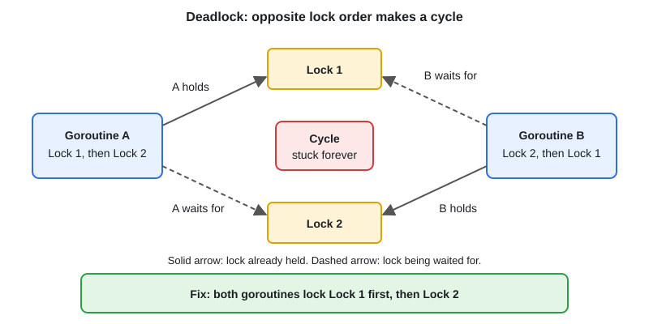

# Race Conditions, Deadlocks & Detection

[← Section index](../README.md) · Prev: [Rate Limiter — Token Bucket](../13-rate-limiter-token-bucket/README.md) · Next: [Timers, Tickers & time Package](../15-timers-tickers-time/README.md)

**Interview weight: 1.3%**  ·  Revise in: 8 min  ·  Run: `go run ./02-concurrency/14-race-conditions-deadlocks-detection`

## In one line
A data race is unsynchronised concurrent access with at least one write; find it with `-race`, fix it with a mutex, atomic or channel, and avoid deadlocks with a fixed lock order.

## Must know
- Data race: two goroutines touch the same memory, one writes, and nothing orders them
- `n++` is read-modify-write, so it is a race even though it looks like one line
- Detect: `go test -race ./...` or `go run -race .`. It only reports races that actually happen in that run, and makes the program slower and heavier
- Concurrent map write or read+write can crash with `fatal error: concurrent map writes`; protect maps with a mutex or `sync.Map`
- Deadlock: goroutines wait on each other forever. The runtime only reports it when every goroutine is blocked
- Partial deadlock (some goroutines stuck, others running) is silent: it shows up as a goroutine leak
- Typical causes: send with no receiver, `Lock` twice (mutexes are not reentrant), two locks taken in opposite order (diagram), `wg.Wait` before draining a channel
- Livelock: goroutines keep reacting but make no progress. Starvation: one goroutine never gets the lock

## Diagram


## Code to remember
```go
// Always lock in the same order, here by id.
func transfer(from, to *account, amt int) {
	first, second := from, to
	if second.id < first.id {
		first, second = second, first
	}
	first.mu.Lock()
	defer first.mu.Unlock()
	second.mu.Lock()
	defer second.mu.Unlock()
	from.balance -= amt
	to.balance += amt
}
```

## Common traps
- Lock then check then act, with the lock released in between (check-then-act race)
- Copying a struct that contains a `sync.Mutex`; `go vet` warns about this
- Holding a lock while calling unknown code or doing I/O
- Believing `-race` found nothing means there are no races

## Interview Q&A

**Q1. How does the race detector work?**

**A:** The compiler instruments memory accesses. At run time it tracks happens-before (guaranteed ordering) between goroutines and reports two accesses to the same address with no ordering where one is a write.

**Q2. What happens if you `Lock` a `sync.Mutex` twice in one goroutine?**

**A:** The second call blocks forever, because Go mutexes are not reentrant. If nothing else is running, the runtime reports a deadlock.

**Q3. How do you find a goroutine leak in production?**

**A:** Watch `runtime.NumGoroutine()` or the pprof goroutine profile over time. If it only grows, fetch `/debug/pprof/goroutine?debug=2` and look at where the stacks are blocked.

**Q4. Four conditions for deadlock?**

**A:** Mutual exclusion, hold and wait, no preemption, circular wait. Breaking one, usually circular wait via lock ordering, prevents it.

**Q5. How do you fix a racy shared counter, and how do you choose?**

**A:** One simple value: `atomic`. Several fields that must change together: a mutex. Data owned by one goroutine that others reach through channels: a channel.

**Q6. Can you run with `-race` in production?**

**A:** Not normally, because it makes the program several times slower and heavier. Run it in CI, load tests and staging; it only catches races that actually happen in that run.
