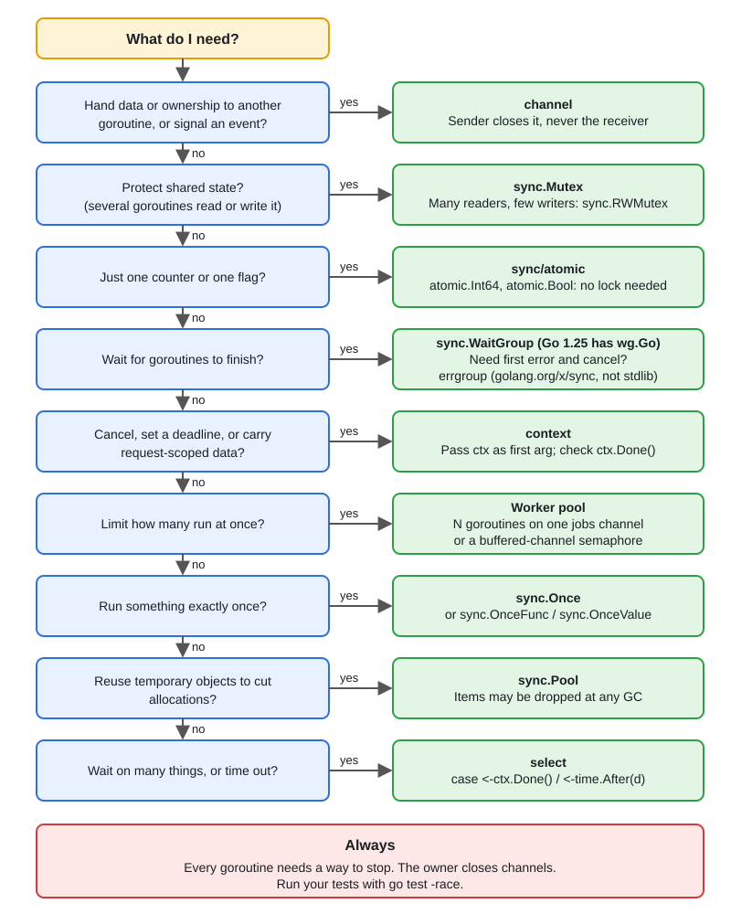
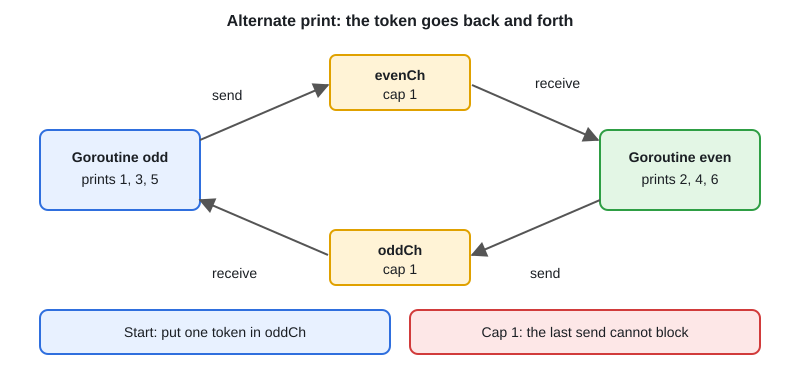

# Classic Concurrency Interview Problems

[← Section index](../README.md) · Prev: [Timers, Tickers & time Package](../15-timers-tickers-time/README.md)

**Interview weight: 1.2%**  ·  Revise in: 8 min  ·  Run: `go run ./02-concurrency/16-classic-concurrency-interview-problems`

## In one line
Live-coding concurrency questions are small variations of six patterns: take turns, producer-consumer, bounded parallelism, merge channels, timeout a call, run N tasks and collect results.

## Must know
- `main.go` has working code for all six; practise typing each from memory
- Alternate print: one buffered(1) channel per goroutine, each hands a token to the other (diagram)
- Producer-consumer: a buffered channel is the bounded buffer; the producer closes it, the consumer `range`s
- Bounded parallelism: acquire a channel semaphore BEFORE `go`, release with `defer` (or a worker pool, topic 09)
- Merge channels: one forwarder goroutine per input, `WaitGroup`, close the output after `Wait` (topic 10)
- Timeout a call: run it in a goroutine that sends on a buffered(1) channel, `select` with `ctx.Done()`
- Run N tasks and collect: each goroutine writes `out[i]` (no lock), then `wg.Wait()`
- Say who closes each channel and how every goroutine exits; mention `go run -race`

## Which tool do I use?


## Diagram


## Code to remember
```go
// Print 1,2,3,... alternating between two goroutines.
odd, even := make(chan struct{}, 1), make(chan struct{}, 1)
odd <- struct{}{} // odd starts
var wg sync.WaitGroup
wg.Go(func() {
	for i := 1; i <= n; i += 2 { <-odd; fmt.Println(i); even <- struct{}{} }
})
wg.Go(func() {
	for i := 2; i <= n; i += 2 { <-even; fmt.Println(i); odd <- struct{}{} }
})
wg.Wait()
```

## Common traps
- Unbuffered batons: the last goroutine hands over to a partner that already exited, so it blocks forever
- Closing the channel from the consumer side
- Missing `wg.Wait()`, or `wg.Add` inside the goroutine
- Using `time.Sleep` to "order" goroutines instead of channels

## Interview Q&A

**Q1. In a timeout wrapper, why is the result channel buffered?**

**A:** After the caller gives up, the slow goroutine still sends. With no buffer it blocks forever (a leak); a buffer of 1 lets it finish and exit.

**Q2. Run 10,000 tasks with at most 20 at once: where does the semaphore go?**

**A:** Before `go`, so the loop blocks and at most 20 goroutines exist. Acquiring inside still creates 10,000 goroutines.

**Q3. How do you return results in input order from concurrent tasks?**

**A:** Pre-size `out`, and goroutine `i` writes only `out[i]`. Read `out` after `wg.Wait()`.

**Q4. Print odd and even numbers from two goroutines in order. Which tool?**

**A:** Two channels as tokens, as above. A mutex alone does not give strict turn-taking.

**Q5. Why can the merged output channel not be closed by each forwarder?**

**A:** A second close panics and an early close breaks senders. Close once, after `wg.Wait()`, from one goroutine.

**Q6. How would you print in order from three goroutines?**

**A:** Make a ring of three channels. Goroutine `k` waits on `ch[k]`, prints, then sends the token to `ch[(k+1)%3]`. It is the two-channel idea again.
