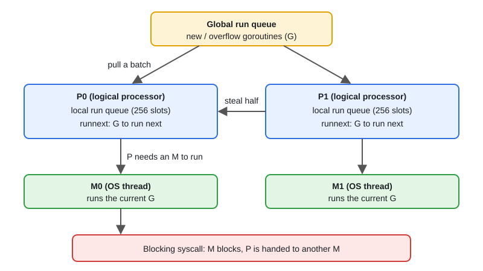
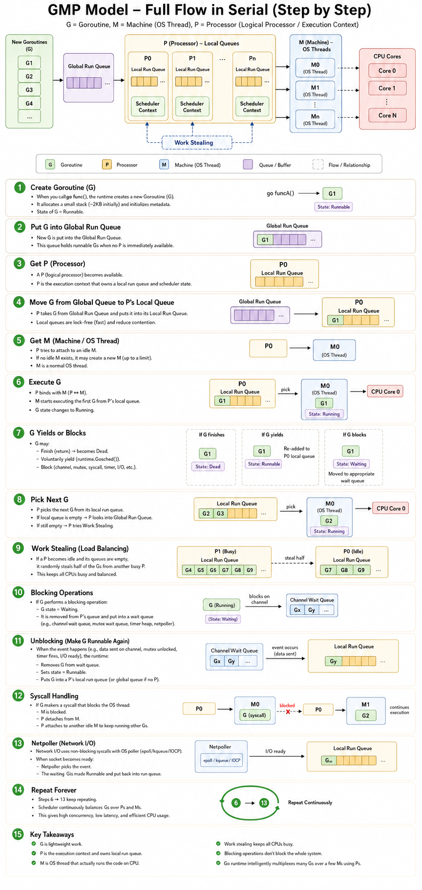

# 01 · The GMP Scheduler

[← Section index](../README.md) · Next: [02 · The Go Memory Model & Happens-Before](../02-memory-model-happens-before/README.md)

**Interview weight: 1.2%**  ·  Revise in: 8 min  ·  Run: `go run ./03-runtime-internals/01-gmp-scheduler`

## In one line
Go multiplexes many goroutines (G) onto few OS threads (M) using logical processors (P), each P with its own run queue.

## Must know
- G = goroutine (starts with a small stack, about 2 KB), M = OS thread, P = processor: the right to run Go code, plus a run queue.
- Number of Ps = `GOMAXPROCS` (default: CPU count; Go 1.25 also respects Linux cgroup CPU limits).
- Each P has a local run queue; there is also a global queue. An idle P steals half of another P's queue.
- Channel/mutex block: only the G is parked, the M immediately runs another G.
- Blocking syscall: the M blocks, the runtime hands the P to another M so other Gs keep running.
- Network I/O uses the netpoller (wraps epoll/kqueue): the G parks and no thread is blocked.
- Since Go 1.14 preemption is asynchronous (signal based), so a tight `for {}` cannot freeze the program.
- Goroutines are cheap, so 100k are fine; unbounded goroutines still cost memory, so bound them.

## Diagram


### Full flow, step by step


Simplification to remember: in the real runtime, `go f()` puts the new G in the current P's local run queue (step 2 and 4 are merged). The global queue mainly takes overflow from full local queues and is checked now and then.

## Code to remember
```go
fmt.Println(runtime.NumCPU())        // CPUs visible
fmt.Println(runtime.GOMAXPROCS(0))   // 0 = just read the number of Ps
fmt.Println(runtime.NumGoroutine())  // live goroutines, handy for leak checks
runtime.Gosched()                    // voluntarily yield the P
```

## Common traps
- Thinking one goroutine equals one OS thread. It does not.
- Old Go (before 1.25) in containers: `GOMAXPROCS` followed host CPUs, not the CPU limit, causing throttling.
- Leaking goroutines blocked forever on a channel: they never get garbage collected.
- Assuming goroutine run order. It is not defined.

## Interview Q&A

**Q1. What are G, M and P?**

**A:** G is a goroutine, M is an OS thread, P is a logical processor holding a run queue. An M needs a P to run Go code.

**Q2. What happens when a goroutine makes a blocking syscall?**

**A:** Its M blocks with it. The runtime detaches the P and gives it to another M, so other goroutines continue.

**Q3. Why are goroutines cheaper than threads?**

**A:** Small growable stack (about 2 KB) instead of a fixed OS stack, switching happens in user space without the kernel, and blocked ones are parked, not tied to a thread.

**Q4. What is work stealing?**

**A:** A P with an empty queue takes about half of the goroutines from another P (or the global queue) to stay busy.

**Q5. Can a `for {}` loop starve other goroutines?**

**A:** Not since Go 1.14. The runtime sends a signal to preempt long-running goroutines.

**Q6. How does Go handle thousands of network connections without a thread per connection?**

**A:** Sockets are non-blocking and registered with the netpoller (epoll/kqueue). A goroutine waiting on I/O is parked, and the runtime wakes it when the socket is ready.
