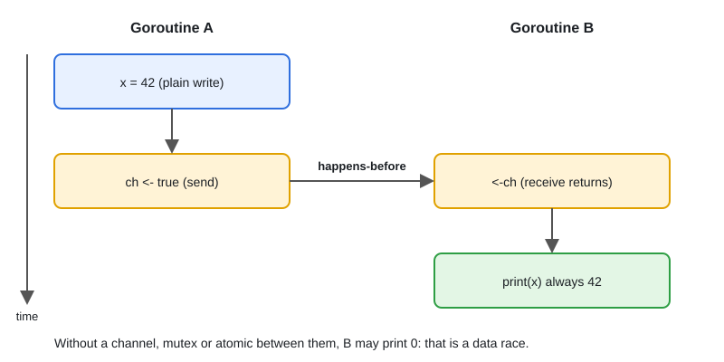

# 02 · The Go Memory Model & Happens-Before

[← Section index](../README.md) · Prev: [01 · The GMP Scheduler](../01-gmp-scheduler/README.md) · Next: [03 · Stack vs Heap & Escape Analysis](../03-stack-heap-escape-analysis/README.md)

**Interview weight: 0.8%**  ·  Revise in: 6 min  ·  Run: `go run ./03-runtime-internals/02-memory-model-happens-before`

## In one line
A write in one goroutine is only guaranteed visible in another if a synchronization event (channel, mutex, atomic, WaitGroup) orders them: happens-before.

## Must know
- Data race = two goroutines touch the same variable, at least one writes, with no ordering between them.
- A channel send happens-before the matching receive completes (see diagram). `close(ch)` happens-before a receive that sees it closed. On an unbuffered channel the receive also happens-before the send completes.
- `mu.Unlock()` happens-before the next `mu.Lock()` returns.
- `wg.Done()` happens-before `wg.Wait()` returns. `once.Do(f)`: f finishes before any `Do` returns.
- `go f()` happens-before f starts. Goroutine exit is NOT a sync point.
- `sync/atomic` operations are sequentially consistent and also create happens-before.
- A plain `bool` flag polled in a loop is a race: the compiler or CPU may never show the update.
- Maps and multi-word values (slices, strings, interfaces) are not safe to share unsynchronized.

## Diagram


## Code to remember
```go
var cur atomic.Pointer[Config]
cur.Store(&Config{Name: "v2"}) // build fully, then publish
c := cur.Load()                // readers always see a complete Config
```

## Common traps
- `for !ready {}` on a plain bool, or "it works on my machine" as proof of correctness.
- Double-checked locking without `sync.Once` or atomics.
- `wg.Add(1)` inside the goroutine, so `Wait` can return early.
- Reading a result after `go f()` with no channel or WaitGroup. Run tests with `go test -race`.

## Interview Q&A

**Q1. What does happens-before mean in Go?**

**A:** If event A happens-before B, then B is guaranteed to see A's writes. Channels, mutexes, WaitGroup, Once and atomics create these edges.

**Q2. Why is a plain bool flag between goroutines wrong?**

**A:** There is no ordering, so the reader may never see the write. Use `atomic.Bool`, a channel, or a mutex.

**Q3. How do you safely publish a config to many readers?**

**A:** Build it completely, then hand it over through a channel, or `atomic.Pointer[T].Store` and `Load`. Do not mutate it afterwards.

**Q4. Data race vs race condition?**

**A:** A data race is unsynchronized access to one variable with at least one write; `-race` detects it. A race condition is any timing-dependent wrong result (e.g. check-then-act under separate locks) and can exist with no data race.

**Q5. How do you find data races?**

**A:** Run tests and builds with `-race`. It reports races that actually occur in that run, so it needs good test coverage.

**Q6. Do atomics give only atomicity, or ordering too?**

**A:** Both. Go atomics are sequentially consistent: an atomic store happens-before the load that sees it, so earlier plain writes become visible. Mixing atomic and plain access to one variable is still a race.
