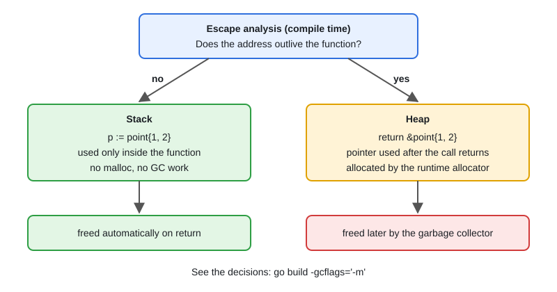

# 03 · Stack vs Heap & Escape Analysis

[← Section index](../README.md) · Prev: [02 · The Go Memory Model & Happens-Before](../02-memory-model-happens-before/README.md) · Next: [04 · The Memory Allocator: mcache → mcentral → mheap](../04-memory-allocator-mcache-mcentral-mheap/README.md)

**Interview weight: 1.0%**  ·  Revise in: 6 min  ·  Run: `go run ./03-runtime-internals/03-stack-heap-escape-analysis`

## In one line
The compiler puts a value on the stack unless its address may outlive the function, in which case it "escapes" to the heap and the GC must clean it up.

## Must know
- You do not choose stack or heap. `new`, `&T{}` and `make` are not placement commands.
- Stack allocation is cheap and freed on return. Heap allocation costs more and adds GC work.
- Common causes of escape: returning a pointer to a local, storing it in a global or heap object, a closure that outlives the call, sending a pointer on a channel.
- Converting a value to an interface (for example passing it to `fmt.Println`) often allocates.
- `make` with a non-constant size, or a very large value, usually goes to the heap.
- Each goroutine has its own stack. It starts small and grows by copying to a bigger one.
- Check with `go build -gcflags='-m'` and measure with `-benchmem` or `testing.AllocsPerRun`.

## Diagram


## Code to remember
```go
func byValue() point    { return point{1, 2} }  // stays in caller's frame
func byPointer() *point { return &point{1, 2} } // "&point{...} escapes to heap"
```
```
go build -gcflags='-m' ./yourpkg   # prints one escape decision per line
```

## Common traps
- "Pointers are always faster": returning pointers to small structs often causes extra heap allocations.
- "`new(T)` is always heap": if it does not escape, it is on the stack.
- Putting hot-path values into `any` or `...any` (logging, `fmt`) and creating garbage.
- Guessing instead of measuring. Always confirm with `-m` or a benchmark.

## Interview Q&A

**Q1. What is escape analysis?**

**A:** A compile-time check of whether a variable's address can outlive its function. If it can, the variable is heap allocated, otherwise it stays on the stack.

**Q2. Name things that make a variable escape.**

**A:** Returning its address, storing it in a global, capturing it in a closure that outlives the call, sending it on a channel, or boxing it into an interface.

**Q3. How do you see what escapes?**

**A:** `go build -gcflags='-m'`. Add `-m -m` for the reason. Then confirm with a benchmark using `-benchmem`.

**Q4. How do goroutine stacks grow?**

**A:** They start small, and when a function needs more space the runtime allocates a bigger stack and copies the old one over. That is why Go can have so many goroutines.

**Q5. How do you reduce allocations on a hot path?**

**A:** Return values instead of pointers when small, pre-size slices with a known capacity, and reuse buffers (for example with `sync.Pool`).

**Q6. Is passing a pointer always cheaper than passing a struct by value?**

**A:** No. Small structs copy cheaply, while a pointer can push the value to the heap and add GC work. Use pointers for large structs, mutation or shared identity.
