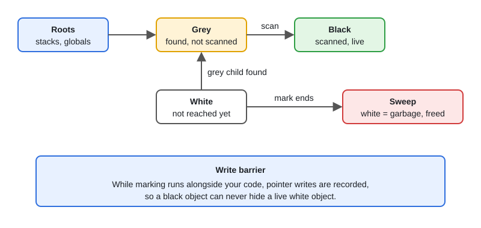
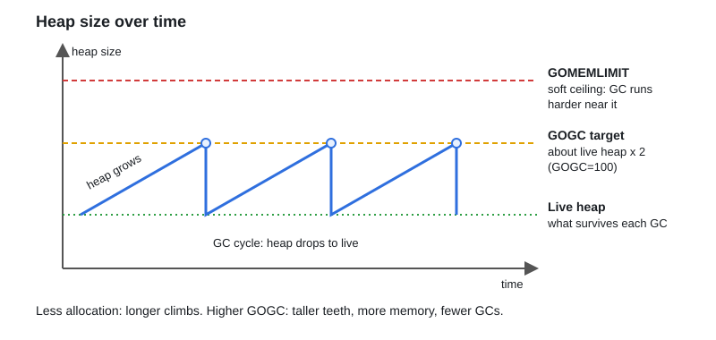
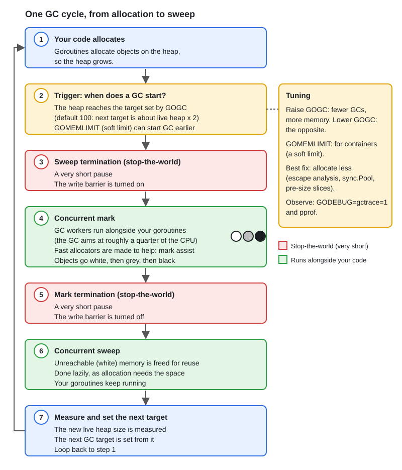

# Garbage Collector

[← Section index](../README.md) · Prev: [04 · The Memory Allocator: mcache → mcentral → mheap](../04-memory-allocator-mcache-mcentral-mheap/README.md) · Next: [pprof Profiling & Tracing](../06-pprof-profiling-tracing/README.md)

**Interview weight: 1.0%**  ·  Revise in: 7 min  ·  Run: `go run ./03-runtime-internals/05-garbage-collector`

## In one line
Go uses a concurrent, non-moving (never compacts), tri-color mark-and-sweep GC that runs alongside your goroutines with only very short pauses.

## Must know
- Tri-color marking: white = not seen yet, grey = seen but children not scanned, black = fully scanned. After marking, white objects are garbage.
- A write barrier (small code the compiler adds to pointer writes) is active while marking runs, so the GC never frees a live object.
- Stop-the-world pauses are short (they only start and finish a cycle). The real cost is CPU used by marking.
- `GOGC` (default 100): next GC starts when the heap has grown 100% over the live data. Higher = fewer GCs, more memory.
- `GOMEMLIMIT` (Go 1.19+) is a SOFT limit, not a hard ceiling: the GC works harder near it (see the heap diagram).
- GC cost depends on live pointer-containing data and allocation rate, not on garbage amount.
- Less allocation means less GC: reuse buffers, pre-size slices, use `sync.Pool` for hot short-lived objects.
- Goroutine stacks and heap objects are both scanned. A leaked goroutine keeps everything it references alive.

## Diagram


### Heap size over time


## End-to-end


## Code to remember
```go
debug.SetGCPercent(200)          // same as GOGC=200
debug.SetMemoryLimit(512 << 20)  // same as GOMEMLIMIT=512MiB (soft limit)
runtime.GC()                     // force a cycle: tests and benchmarks only
// GODEBUG=gctrace=1 ./app       // one line per GC cycle
```

## Common traps
- Treating `GOMEMLIMIT` as a hard cap. If live data nears it, the GC burns a lot of CPU and slows the app.
- Setting `GOMEMLIMIT` equal to the container limit. Leave headroom for stacks and non-heap memory.
- Calling `runtime.GC()` in production code.
- Believing "Go has no GC tuning". `GOGC` and `GOMEMLIMIT` are the two knobs.

## Interview Q&A

**Q1. How does Go's GC work?**

**A:** Concurrent tri-color mark and sweep. It marks reachable objects while the program runs, using a write barrier to stay correct, then sweeps unmarked ones.

**Q2. What is GOGC?**

**A:** The percentage of heap growth over live data that triggers the next cycle. 100 means the heap may roughly double before the next GC.

**Q3. What is GOMEMLIMIT and how does it differ from GOGC?**

**A:** GOGC is relative to live data. GOMEMLIMIT sets a soft total memory target: the GC becomes more aggressive near it. It is not a hard limit. `GOGC=off` plus `GOMEMLIMIT` means the GC runs only near the limit.

**Q4. Your service has GC pauses or high GC CPU. What do you do?**

**A:** Profile allocations with pprof (`alloc_space`), cut allocations, reuse buffers, then tune GOGC or GOMEMLIMIT. Check with `GODEBUG=gctrace=1`.

**Q5. What is a write barrier?**

**A:** Code the compiler adds on pointer writes while marking is active, so concurrent changes do not hide live objects from the GC.

**Q6. Is Go's GC generational or compacting?**

**A:** Neither. It is non-generational (each cycle marks the whole live heap) and non-moving (objects keep their address, nothing is compacted).

**Q7. What is mark assist?**

**A:** If a goroutine allocates faster than the GC can mark, the runtime makes that goroutine do some marking work first. This slows allocation so the cycle can finish in time.
