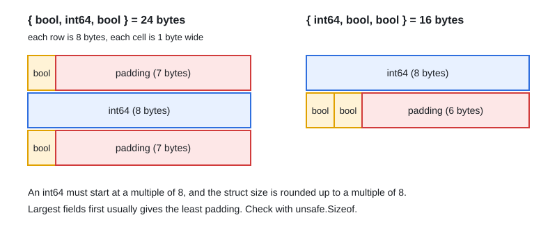

# Data Structure Internals & Memory Layout

[← Section index](../README.md) · Prev: [pprof Profiling & Tracing](../06-pprof-profiling-tracing/README.md) · Next: [Runtime Interview Questions (Q&A Bank)](../08-runtime-interview-questions/README.md)

**Interview weight: 0.5%**  ·  Revise in: 3 min  ·  Run: `go run ./03-runtime-internals/07-data-structure-internals-memory-layout`
Optional / low priority

## In one line
Slices, strings and interfaces are small headers pointing at data, and struct field order changes struct size because of alignment padding.

## Must know
- Slice = pointer + len + cap (24 bytes on 64-bit). String = pointer + len (16 bytes).
- Interface = type info + data pointer (16 bytes). A map or channel variable is a single pointer.
- Struct fields are aligned, so padding is added. Ordering fields largest to smallest minimizes size (see diagram).
- Maps use Swiss tables since Go 1.24. Map keys must be comparable.

## Diagram

## Common traps
- Copying a slice copies only the header, so both share the same array.
- Reordering fields rarely matters unless you hold millions of the struct.

## Interview Q&A

**Q1. How do you reduce the size of a struct?**

**A:** Order fields from largest to smallest alignment, so there is less padding. Check with `unsafe.Sizeof`.

**Q2. What is inside a slice?**

**A:** A pointer to the backing array, a length and a capacity. Passing a slice passes a copy of this header.
