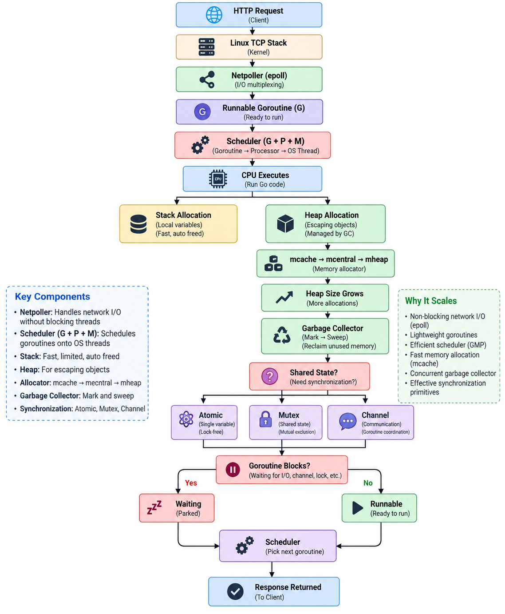

# Runtime Interview Questions (Q&A Bank)

[← Section index](../README.md) · Prev: [Data Structure Internals & Memory Layout](../07-data-structure-internals-memory-layout/README.md)

**Interview weight: 1.1%**  ·  Revise in: 6 min  ·  Run: `go run ./03-runtime-internals/08-runtime-interview-questions`

## In one line
Be able to explain, in two sentences each: GMP, stack vs heap, GC and its knobs, and how you would profile a slow or leaking service.

## Must know
- G = goroutine, M = OS thread, P = logical processor (`GOMAXPROCS`). An M needs a P to run Go code.
- Idle Ps steal work. Blocked syscalls hand the P to another M. Preemption is signal based since Go 1.14.
- Goroutine stacks start small and grow by copying. Escape analysis decides stack vs heap.
- GC is concurrent tri-color mark-sweep. Knobs: `GOGC` and `GOMEMLIMIT` (soft limit).
- `sync.Pool` reuses temporary objects. Items may be dropped at any GC, so never use it for connections.
- Finalizers (`runtime.SetFinalizer`) run after an object is unreachable, with no timing guarantee. Use `defer Close()` instead.
- Tools: `-race` for data races, `go build -gcflags='-m'` for escapes, pprof for CPU, memory and goroutines, `GODEBUG=gctrace=1` for GC.

## Big picture: one request through the runtime


## Code to remember
```go
var bufPool = sync.Pool{New: func() any { return new(bytes.Buffer) }}

buf := bufPool.Get().(*bytes.Buffer)
defer bufPool.Put(buf)
buf.Reset() // always reset before reuse
```

## Common traps
- Using `sync.Pool` for connections, or forgetting to reset pooled objects.
- Saying "one goroutine = one thread" or "Go has no GC tuning".
- Calling `runtime.GC()` in production code, or relying on finalizers for cleanup.

## Interview Q&A

**Q1. Explain GMP. How many goroutines run truly in parallel?**

**A:** G = goroutine, M = OS thread, P = logical processor with a run queue. An M needs a P to run Go code, so at most `GOMAXPROCS` goroutines run at once. The rest wait or are parked.

**Q2. What happens when a goroutine blocks on a channel versus a syscall?**

**A:** Channel: the goroutine is parked and the thread runs another one. Syscall: the thread blocks, so the P moves to another thread.

**Q3. How does Go decide stack or heap?**

**A:** Escape analysis at compile time: if a value's address can outlive the function, it goes to the heap, else the stack. Check with `-gcflags='-m'`.

**Q4. How does the GC work and what does `GOGC` do?**

**A:** Concurrent tri-color mark and sweep with a write barrier and short stop-the-world pauses. `GOGC=100` starts the next cycle when the heap has grown 100% over live data.

**Q5. A service's memory keeps growing. What do you check?**

**A:** Heap profile `inuse_space` (diff two profiles), goroutine count for leaks, then unbounded caches or maps.

**Q6. Should you use `runtime.SetFinalizer` to release resources?**

**A:** No. A finalizer runs after the object is unreachable, with no timing guarantee, and may never run before exit. Release resources explicitly with `defer Close()`.
