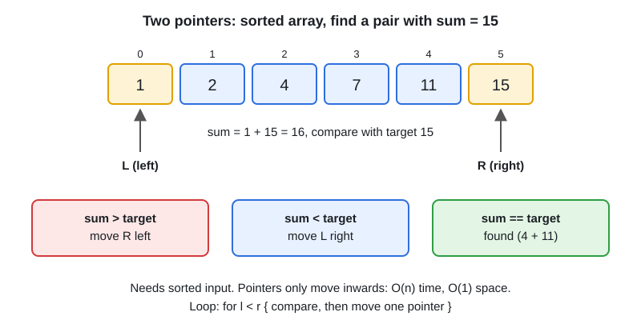

# 02 · Arrays, Two Pointers, Prefix Sum

[← Section index](../README.md) · Prev: [01 · Big-O and the Go Toolkit for DSA](../01-big-o-and-go-toolkit-for-dsa/README.md) · Next: [03 · Sliding Window](../03-sliding-window/README.md)

**Interview weight: 1.2%**  ·  Revise in: 10 min  ·  Run: `go run ./04-dsa/02-arrays-two-pointers-prefix-sum`

## In one line
Sorted array or "pair/triplet with a condition" means two pointers; "sum of a range" or "count subarrays with sum k" means prefix sums.

## Must know
- Two pointers from both ends: the array is sorted (or can be sorted) and you look for a pair. O(n) time, O(1) space.
- Same-direction pointers (read and write): in-place filter, remove duplicates, move zeroes.
- Move the pointer that can still improve the answer. For container with most water, move the shorter wall.
- Prefix sum: `sum(i..j) = prefix[j+1] - prefix[i]`. Build once in O(n), then each range query is O(1).
- Prefix sum plus a map counts subarrays with sum k, and it works with negative numbers (sliding window does not).
- Seed the map with `{0: 1}` for the empty prefix, or you miss subarrays starting at index 0.
- 3Sum: sort, fix one element, run two pointers on the rest, skip duplicates. O(n^2).
- If you sort first, say so: it adds O(n log n) and may lose the original indices.

## Diagram


## Code to remember
```go
l, r := 0, len(nums)-1
for l < r {
	switch sum := nums[l] + nums[r]; {
	case sum == target:
		return l, r
	case sum < target:
		l++
	default:
		r--
	}
}
```

## Common traps
- Using `l <= r` when the pair needs two different elements.
- Forgetting the `{0: 1}` seed in the prefix-sum map.
- Two pointers on an unsorted array without sorting first.
- Not skipping duplicates in 3Sum, which gives repeated triplets.

## Interview Q&A

**Q1. Two sum on a sorted array in O(1) space?**

**A:** Two pointers from both ends. If the sum is too big move the right pointer left, if too small move the left pointer right.

**Q2. Why does two pointers work on sorted input?**

**A:** Each move safely discards an element: if the sum is too large, the right value cannot pair with anything at or right of l.

**Q3. Count subarrays with sum k, including negatives?**

**A:** Running prefix sum plus a map of prefix counts. For each prefix add `seen[prefix-k]` to the answer. O(n).

**Q4. Why not a sliding window for that?**

**A:** Negative numbers break the rule that growing the window increases the sum, so the window cannot decide when to shrink.

**Q5. Remove duplicates or move zeroes in place with O(1) space?**

**A:** Same-direction pointers: `r` reads every element, `w` marks the next write slot; copy when the element is wanted, then `w++`. O(n) time.
