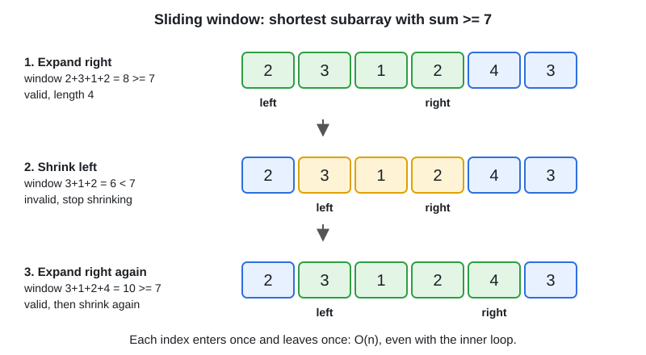

# 03 · Sliding Window

[← Section index](../README.md) · Prev: [02 · Arrays, Two Pointers, Prefix Sum](../02-arrays-two-pointers-prefix-sum/README.md) · Next: [04 · Hashing & HashMap Problems](../04-hashing-hashmap-problems/README.md)

**Interview weight: 1.2%**  ·  Revise in: 10 min  ·  Run: `go run ./04-dsa/03-sliding-window`

## In one line
"Longest, shortest or best contiguous subarray or substring with a condition" means a window that expands on the right and shrinks on the left.

## Must know
- Fixed size k: add the new element, remove the one leaving. O(n).
- Variable size, longest: expand right, shrink left when the window becomes invalid, record the best after each step.
- Variable size, shortest: expand right until valid, then shrink left while still valid, recording the best.
- It is O(n) even with a nested loop, because each index enters and leaves the window at most once.
- Track window state with a running sum, or a map or `[26]int` of counts.
- Needs non-negative numbers when the condition is a sum. With negatives use prefix sums (folder 02).
- Window maximum needs a monotonic deque (folder 07).

## Diagram


## Code to remember
```go
left := 0
for right := 0; right < len(nums); right++ {
	// add nums[right] to the window state
	for /* window invalid (or still valid, for shortest) */ {
		// remove nums[left] from the window state
		left++
	}
	// update the best answer using right-left+1
}
```

## Common traps
- Off by one in the window length: it is `right - left + 1`.
- Moving `left` backwards in the "longest unique substring" jump: only jump when `last[c] >= left`.
- Updating the answer in the wrong place: for longest, after the shrink loop; for shortest, inside it.
- Using a window when the array has negatives and the condition is a sum.

## Interview Q&A

**Q1. Longest substring without repeating characters?**

**A:** Map each character to its last index. On a repeat inside the window, move left to last index + 1. O(n) time, O(alphabet) space.

**Q2. How do you recognise a sliding window problem?**

**A:** The input is a sequence, the target is contiguous, and you want a min, max or count under a condition that can be updated incrementally.

**Q3. Why is the complexity O(n) with a loop inside a loop?**

**A:** Left and right each move forward at most n times in total, so the work is at most 2n steps.

**Q4. Fixed versus variable window?**

**A:** Fixed: size given, slide by one. Variable: size is the answer, so expand and shrink by the condition.

**Q5. Smallest subarray with sum at least target (positive numbers)?**

**A:** Variable window, shortest: add `nums[right]`, then while sum >= target record `right-left+1` and shrink from the left. O(n) time, O(1) space.
