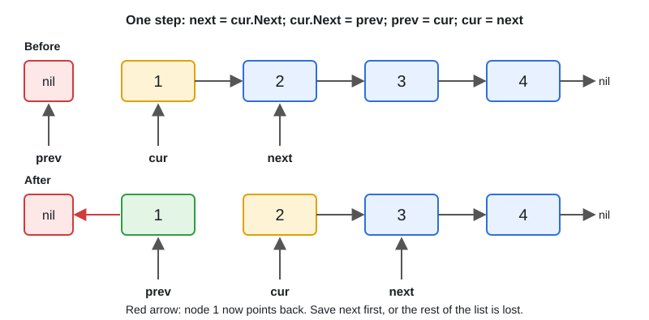

# 06 · Linked List

[← Section index](../README.md) · Prev: [String Problems](../05-strings-problems/README.md) · Next: [07 · Stack, Queue & Monotonic Stack/Deque](../07-stack-queue-monotonic/README.md)

**Interview weight: 1.0%**  ·  Revise in: 8 min  ·  Run: `go run ./04-dsa/06-linked-list`

## In one line
Reverse, merge, find the middle, detect a cycle or remove the nth node: use a dummy head, prev/cur pointers, or a slow and fast pair.

## Must know
- Node: `type ListNode struct { Val int; Next *ListNode }`. Check `nil` before every `.Next`.
- Reverse in place with `prev`, `cur`, `next` (see diagram). O(n) time, O(1) space.
- Slow and fast pointers: fast moves 2, slow moves 1. When fast reaches the end, slow is at the middle.
- Floyd cycle detection: if fast and slow meet, there is a cycle. O(1) space (a map of visited nodes costs O(n)).
- Dummy head node removes special cases when the head can change (merge, delete).
- Remove nth from the end: advance fast n steps, then move both until fast is last; slow is before the target.
- Linked lists have O(1) insert or delete at a known node, O(n) access by index.
- In Go interviews the list is usually hand-built; `container/list` exists but is rarely used for these problems.

## Diagram


## Code to remember
```go
func reverse(head *ListNode) *ListNode {
	var prev *ListNode
	for cur := head; cur != nil; {
		next := cur.Next
		cur.Next = prev
		prev, cur = cur, next
	}
	return prev
}
```

## Common traps
- Losing the rest of the list by overwriting `cur.Next` before saving it.
- Nil dereference on `fast.Next.Next`: check `fast != nil && fast.Next != nil`.
- Forgetting to return `dummy.Next`, not `dummy`.
- Off by one when stopping `fast` for remove-nth (stop at `fast.Next == nil`).

## Interview Q&A

**Q1. How do you detect a cycle with O(1) space?**

**A:** Floyd's tortoise and hare. If the fast pointer ever equals the slow pointer there is a cycle; if it hits nil there is none.

**Q2. How do you find the middle in one pass?**

**A:** Move fast two steps and slow one step. When fast reaches the end, slow is the middle.

**Q3. Why use a dummy node?**

**A:** It gives the head a predecessor, so inserting or deleting the first node needs no special case.

**Q4. Array versus linked list?**

**A:** Array has O(1) index access and cache-friendly layout; a list has O(1) insert and delete at a known node but O(n) search.

**Q5. Reverse a linked list: walk me through it and give the complexity.**

**A:** Save `next`, point `cur.Next` at `prev`, then advance `prev` and `cur`. O(n) time, O(1) space; the recursive version uses O(n) stack.

**Q6. Remove the nth node from the end in one pass?**

**A:** Use a dummy head. Move fast n steps ahead, then move both until fast is the last node; slow.Next is the node to delete. O(n) time, O(1) space.
