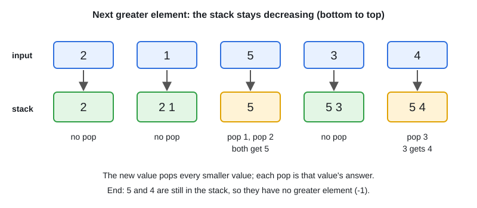

# 07 · Stack, Queue & Monotonic Stack/Deque

[← Section index](../README.md) · Prev: [06 · Linked List](../06-linked-list/README.md) · Next: [08 · Binary Search](../08-binary-search/README.md)

**Interview weight: 1.0%**  ·  Revise in: 8 min  ·  Run: `go run ./04-dsa/07-stack-queue-monotonic`

## In one line
Matching brackets or "next greater/smaller element" means a stack; "max of every window" means a monotonic deque.

## Must know
- Stack in Go: a slice. Push `s = append(s, x)`, top `s[len(s)-1]`, pop `s = s[:len(s)-1]`. Check `len(s) > 0` first.
- Queue: a slice with `q = q[1:]` for pops (fine for interviews), or a linked list for strict O(1).
- Brackets and nested structures: push openers, pop and compare on closers.
- Monotonic stack (see diagram): a new element pops everything it beats, and those pops are the answers.
- Each element is pushed and popped once, so the monotonic stack is O(n) despite the inner loop.
- Monotonic deque: front is the window max, pop from the back while the new value is bigger, pop from the front when it leaves the window.
- Queue from two stacks (`in` and `out`): refill `out` only when empty. Amortized O(1).
- Typical problems: valid parentheses, daily temperatures, next greater element, sliding window maximum.

## Diagram


## Code to remember
```go
var stack []int // indices
for i, t := range temps {
	for len(stack) > 0 && temps[stack[len(stack)-1]] < t {
		j := stack[len(stack)-1]
		stack = stack[:len(stack)-1]
		res[j] = i - j // temps[i] is the next greater for j
	}
	stack = append(stack, i)
}
```

## Common traps
- Popping from an empty slice (panic): guard with `len(stack) > 0`.
- Storing values when the answer needs indices (distances, window bounds).
- Using `<` versus `<=` wrongly with duplicates.
- Leftover items in the stack: decide whether they mean "no answer" (leave zero) or "invalid" (bracket problem).

## Interview Q&A

**Q1. Why is the monotonic stack O(n)?**

**A:** Each index is pushed once and popped at most once, so total work is 2n even though there is a loop inside the loop.

**Q2. When do you use a monotonic stack?**

**A:** When for each element you need the nearest element to its right or left that is greater or smaller.

**Q3. Sliding window maximum in O(n)?**

**A:** Keep a deque of indices with decreasing values. Drop smaller values from the back, drop the front if it left the window, and the front is the max.

**Q4. Implement a queue using two stacks?**

**A:** Push to `in`. On pop, if `out` is empty move everything from `in` to `out`, then pop `out`. Amortized O(1).

**Q5. Valid parentheses: approach and edge cases?**

**A:** Push openers, and on a closer pop and compare. Fail on an empty stack or a mismatch, and fail at the end if the stack is not empty. O(n) time, O(n) space.
