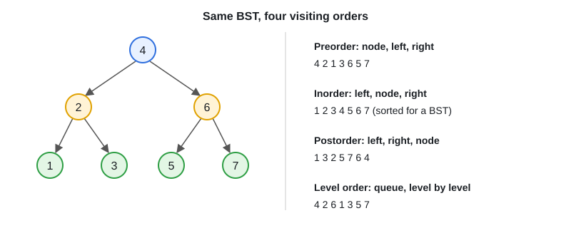

# 11 · Binary Tree & BST

[← Section index](../README.md) · Prev: [10 · Recursion & Backtracking](../10-recursion-backtracking/README.md) · Next: [12 · Heap / Priority Queue / Top-K](../12-heap-priority-queue-topk/README.md)

**Interview weight: 1.1%**  ·  Revise in: 10 min  ·  Run: `go run ./04-dsa/11-binary-tree-bst`

## In one line
Tree question: recurse on left and right and combine (depth, paths, validity), or use a queue when it says "level by level".

## Must know
- DFS = recursion: base case `nil`, then combine the left and right answers.
- BFS = queue; process `len(queue)` nodes at a time to get one level.
- Preorder/inorder/postorder differ only in where you visit the node (diagram below). Inorder of a BST is sorted.
- BST search/insert is O(h): O(log n) balanced, O(n) skewed.
- Complexity: traversals O(n) time, O(h) space for DFS, O(w) for BFS (w = widest level).
- Validate a BST with a (lo, hi) range, not by comparing only with the parent.
- LCA in a BST: go left if both values are smaller, right if both larger, else current node is the LCA.

## Diagram


## Code to remember
```go
func maxDepth(n *Node) int {
	if n == nil {
		return 0
	}
	return 1 + max(maxDepth(n.Left), maxDepth(n.Right))
}
```

## Common traps
- Checking only parent-child order for BST validity (misses deeper violations).
- Forgetting the `nil` base case, or calling methods on a nil child.
- Taking `queue[0]` before checking `len(queue) > 0`.
- Deep recursion on a skewed tree (Go stacks grow, so it works, but mention it).

## Interview Q&A

**Q1. DFS or BFS for a tree?**

**A:** DFS for depth, paths, and subtree properties. BFS for level order and shortest distance from the root.

**Q2. Which traversal sorts a BST?**

**A:** Inorder (left, node, right).

**Q3. Time and space of tree DFS?**

**A:** O(n) time, O(h) stack space. h is log n if balanced, n if skewed.

**Q4. How do you validate a BST?**

**A:** Pass min and max bounds down the recursion. Every node must be strictly inside them.

**Q5. Lowest common ancestor in a general binary tree?**

**A:** Recurse both sides. If both return non-nil, the current node is the LCA.

**Q6. Recursion or iteration for tree traversal?**

**A:** Recursion is shorter and fine for balanced trees. Use an explicit stack when the tree can be very deep or the interviewer asks for no recursion.
