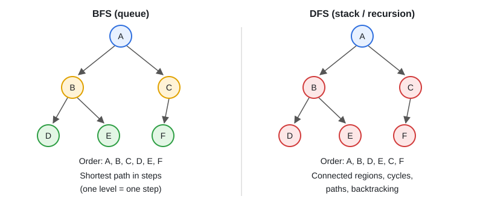

# 13 · Graphs: BFS, DFS, Topological Sort, Union-Find, Dijkstra

[← Section index](../README.md) · Prev: [12 · Heap / Priority Queue / Top-K](../12-heap-priority-queue-topk/README.md) · Next: [14 · Dynamic Programming](../14-dynamic-programming/README.md)

**Interview weight: 1.0%**  ·  Revise in: 12 min  ·  Run: `go run ./04-dsa/13-graphs-bfs-dfs-topological-sort-union-find`

## In one line
Grid, network, or "dependencies": BFS for shortest path in steps, DFS for connected regions, Kahn's algorithm for ordering, union-find for groups.

## Must know
- Store a graph as an adjacency list: `[][]int` or `map[int][]int`.
- BFS (queue) gives the shortest path in an unweighted graph. DFS (recursion) explores a region.
- Always keep a `visited` set. Mark when you enqueue, not when you dequeue.
- Islands (grid DFS): from each `1`, recurse in 4 directions and set cells to `0`; count the starts.
- Topological sort (Kahn): queue nodes with indegree 0. If fewer than n come out, there is a cycle.
- Union-find: `Find` with path compression, `Union` merges. Good for components and cycles in undirected graphs.
- Weighted shortest path: Dijkstra with a min-heap (non-negative weights only), O((V+E) log V).
- Complexity: BFS/DFS/Kahn O(V+E). Grid: O(rows*cols).

## Diagram


## Code to remember
```go
dist[src] = 0
queue := []int{src}
for len(queue) > 0 {
	u := queue[0]
	queue = queue[1:]
	for _, v := range adj[u] {
		if dist[v] == -1 { // not visited
			dist[v] = dist[u] + 1
			queue = append(queue, v)
		}
	}
}
```

## Common traps
- Marking visited on dequeue (the same node gets queued many times).
- Forgetting disconnected components: loop over all start nodes.
- Using BFS distance on a weighted graph (use Dijkstra).
- Directed vs undirected: add the edge both ways only for undirected.

## Interview Q&A

**Q1. BFS or DFS for shortest path?**

**A:** BFS when all edges have equal weight. DFS does not find the shortest path.

**Q2. How do you detect a cycle in a directed graph?**

**A:** Kahn's algorithm (output smaller than n means a cycle), or DFS with an "on current path" mark.

**Q3. Where is union-find used?**

**A:** Number of connected components, redundant connection, grouping accounts. Near O(1) per operation.

**Q4. Course schedule problem?**

**A:** Build edges prerequisite to course, run Kahn's. If all courses come out, it is possible.

**Q5. When Dijkstra instead of BFS, and what are its limits?**

**A:** Use it when edges have different weights. It fails with negative weights (use Bellman-Ford). O((V+E) log V) with a min-heap.
