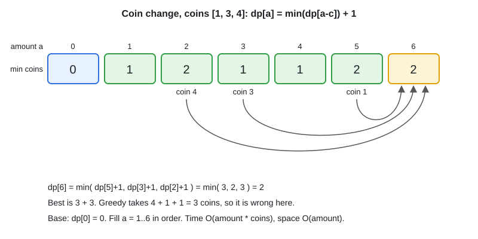

# 14 · Dynamic Programming

[← Section index](../README.md) · Prev: [13 · Graphs: BFS, DFS, Topological Sort, Union-Find, Dijkstra](../13-graphs-bfs-dfs-topological-sort-union-find/README.md) · Next: [Trie (Prefix Tree)](../15-trie/README.md)

**Interview weight: 0.8%**  ·  Revise in: 10 min  ·  Run: `go run ./04-dsa/14-dynamic-programming`

## In one line
"Minimum / maximum / count the ways" where a brute-force recursion repeats the same subproblems: store each answer once in a table.

## Must know
- Steps: define the state, write the recurrence, set base cases, pick the fill order.
- Top-down = recursion + memo (map or slice). Bottom-up = fill a table in order.
- 1D patterns: climbing stairs, house robber, coin change. 2D patterns: LCS, edit distance, grid paths.
- If `dp[i]` only needs the last one or two values, keep two variables (O(1) space).
- Stairs: `dp[i] = dp[i-1] + dp[i-2]`. House robber: `dp[i] = max(dp[i-1], dp[i-2] + nums[i])`.
- Coin change: `dp[a] = min(dp[a-c]) + 1` (table below). Use `amount+1` as "infinity", not `math.MaxInt` (overflow on `+1`).
- Complexity = number of states times work per state. Coin change O(amount * coins), LCS O(n*m).
- Greedy fails when a local best choice blocks the global best (coins `[1,3,4]`, amount 6: greedy 4+1+1, best 3+3).

## Diagram


## Code to remember
```go
dp := make([]int, amount+1)
for a := 1; a <= amount; a++ {
	dp[a] = amount + 1 // infinity
	for _, c := range coins {
		if c <= a {
			dp[a] = min(dp[a], dp[a-c]+1)
		}
	}
}
```

## Common traps
- Wrong base case (`dp[0]`) or off-by-one in table size (`n+1`).
- Overflow when "infinity" is `math.MaxInt` and you add 1.
- Memoising on the wrong state, so the cache misses or returns wrong answers.
- Iterating the knapsack loop in the wrong direction (0/1 vs unbounded).

## Interview Q&A

**Q1. How do you know a problem is DP?**

**A:** Overlapping subproblems and optimal substructure: the best answer is built from best answers of smaller inputs.

**Q2. Memoisation vs tabulation?**

**A:** Same complexity. Memo is easier to write from the recurrence. Tabulation avoids recursion depth and is easy to space-optimise.

**Q3. DP vs greedy?**

**A:** Greedy commits to one choice and needs a proof. DP tries all choices and keeps the best.

**Q4. How do you cut space in 2D DP?**

**A:** If a row depends only on the previous row, keep two rows (or one) instead of the full table.

**Q5. Coin change: complexity and the unreachable case?**

**A:** O(amount * coins) time, O(amount) space. If `dp[amount] > amount` after filling, no combination works, so return -1.
