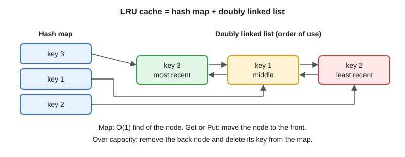

# LRU & LFU Cache Design

[← Section index](../README.md) · Prev: [Trie (Prefix Tree)](../15-trie/README.md) · Next: [Intervals & Greedy](../17-intervals-greedy/README.md)

**Interview weight: 1.1%**  ·  Revise in: 8 min  ·  Run: `go run ./04-dsa/16-lru-lfu-cache-design`

## In one line
"Cache with O(1) get and put that evicts the least recently used item": a hash map for lookup plus a doubly linked list for order.

## Must know
- Why both: a map alone has no order; a list alone needs O(n) lookup. Together, both are O(1).
- Map: `key -> list node`. List: front = most recent, back = least recent.
- Get: look up, move node to front, return value.
- Put: if the key exists, update and move to front. Otherwise add to front; if over capacity, remove the back node and delete its key from the map.
- The node must store the key, so you can delete it from the map on eviction.
- A doubly linked list gives O(1) removal from the middle; a slice or singly linked list does not.
- Go: `container/list` gives you the list, `MoveToFront` and `Back`.
- Not goroutine-safe: guard with `sync.Mutex` (not `RWMutex`, because `Get` also changes the order).
- LFU: also track a use count per key, plus a map from count to list; evict from the lowest count. Rarely coded in full at mid-level.

## Diagram


## Code to remember
```go
func (c *LRU) Put(key, val int) {
	if el, ok := c.items[key]; ok {
		el.Value.(*entry).val = val
		c.order.MoveToFront(el)
		return
	}
	if c.order.Len() == c.cap {
		oldest := c.order.Back()
		c.order.Remove(oldest)
		delete(c.items, oldest.Value.(*entry).key)
	}
	c.items[key] = c.order.PushFront(&entry{key, val})
}
```

## Common traps
- Not storing the key in the node (cannot delete from the map on eviction).
- Forgetting to move to front on a `Put` that updates an existing key.
- Using `RWMutex.RLock` for `Get` (it mutates the list).

## Interview Q&A

**Q1. Why a doubly linked list?**

**A:** To remove a node from the middle in O(1) when it is accessed. A singly linked list needs a search.

**Q2. Time complexity?**

**A:** O(1) for Get and Put. Space O(capacity).

**Q3. How do you make it thread-safe?**

**A:** One `sync.Mutex` around Get and Put. For high contention, shard the cache by key hash.

**Q4. LRU vs LFU?**

**A:** LRU evicts by recency, LFU by frequency. LFU resists one-time scans but is more complex and slow to forget old hot keys.
