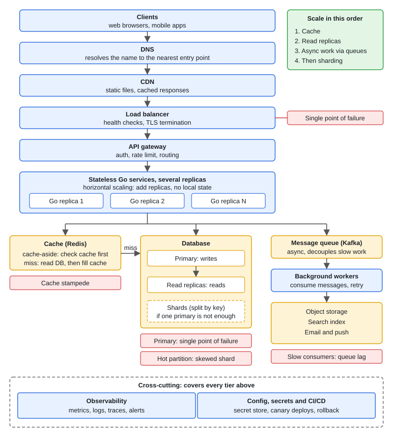

# Fundamentals: Scalability, Availability, Latency

[← Section index](../README.md) · Next: [Load Balancing and Caching Strategies](../02-load-balancing-and-caching-strategies/README.md)

**Interview weight: 1.1%**  ·  Revise in: 8 min

## In one line
Scale the stateless tier out, measure latency in percentiles not averages, and treat availability as arithmetic: dependencies in series multiply, redundancy in parallel helps.

## Must know
- Vertical scaling is simple but has a ceiling and is a single point of failure (SPOF). Horizontal needs a load balancer and state kept outside the app (DB, Redis, object store).
- Stateless means any replica can serve any request. Sticky sessions are a smell.
- Series: `A = A1 x A2`. Three 99.9% hops give about 99.7%. Parallel: `A = 1 - (1 - a)^n`, only if failures are independent.
- Nines per year: 99.9% is about 8.8 h, 99.99% about 52 min, 99.999% about 5 min.
- Report p50, p95, p99 (p99 = 99% of requests are faster than this). A mean can hide a bad tail. Do not average per-pod percentiles; use histograms.
- Fan-out to N services, each slow with probability q: user sees slow with `1 - (1 - q)^N`. At N=100, q=1% that is about 63%.
- SLI is what you measure, SLO is the internal target, SLA is the external contract (looser). Error budget = `1 - SLO`.
- RTO is how long to restore service; RPO is how much data you can lose. Load shedding (429/503) protects the requests you do serve.

## Reference architecture

## Design in 5 steps
Use this for any "estimate and size it" opener. Numbers below are illustrative, not real data.
1. **Requirements:** functional scope, plus targets (for example 99.9% availability, p99 under 300 ms).
2. **Estimates:** DAU x actions per day, divided by about 10^5 seconds, gives average QPS. Multiply by a peak factor of 2-5x. Storage = writes/day x bytes x retention x 3 replicas. Example: 10M DAU x 10 actions = 10^8/day, about 1,000 QPS average, about 3,000 peak.
3. **API + data model:** split read and write paths using the read:write ratio (often 10:1 to 100:1).
4. **Architecture:** stateless services behind an LB across 2+ AZs (availability zones: separate data centres in a region), cache for reads, primary + replicas for the DB, queue for slow work.
5. **Bottlenecks and trade-offs:** DB first. Name SPOFs, retry storms, cache stampede. Plan for 60-70% utilisation. Sync replication gives zero RPO but slower writes; async is faster but can lose data.

## Common traps
- Using the redundancy formula when replicas share an AZ, config push or bad deploy.
- Quoting average latency; at high utilisation latency climbs steeply (queueing).
- Sharding too early. Scale the DB up first, because sharding is hard to undo.
- Retries with no budget or backoff, which amplify an outage.

## Interview Q&A

**Q1. We need four nines. What does that imply?**

**A:** About 52 min downtime a year. Every sync dependency multiplies into that budget, so a 99.9% DB alone breaks it. Add redundancy across AZs, take the DB off the critical path with cache or queue, and use canary deploys with fast rollback.

**Q2. How do you scale a single server to millions of users?**

**A:** Make the app stateless and move state to DB/Redis, add an LB and more instances, cache reads, add DB read replicas, push slow work to a queue, use a CDN for static files. Shard the DB last. Two 99.9% services in series give about 99.8%, so every hop costs availability.

**Q3. p50 is 20 ms but users complain. Why?**

**A:** The tail. Check p99 and p99.9. Fan-out, GC pauses, lock contention and retries create slow outliers. Fix with deadlines, fewer hops, hedged requests (send a second copy of a slow request), and alerts on percentiles.

**Q4. Active-active vs active-passive?**

**A:** Active-active uses all capacity and fails over fast but needs write conflict handling. Active-passive has one writer, which is simpler, but costs idle capacity and an RTO of seconds to minutes.

**Q5. Load shedding vs rate limiting?**

**A:** Rate limiting is a per-client quota. Load shedding rejects work based on server state (queue depth, in-flight count) so served requests stay within SLO. Shed low-priority traffic first, never health checks.

**Q6. Scalability vs availability: what is the difference?**

**A:** Scalability is handling more load by adding resources. Availability is staying up when parts fail. Stateless replicas across AZs give both; one big DB primary can scale up yet stay a single point of failure.

**Q7. SLI vs SLO vs SLA, and what is an error budget?**

**A:** SLI is the measured number (success rate, p99), SLO the internal target (99.9% over 30 days), SLA the looser external contract with penalties. The budget is `1 - SLO`, about 43 min a month at 99.9%. Spend it on releases; freeze risky changes when it is gone.
