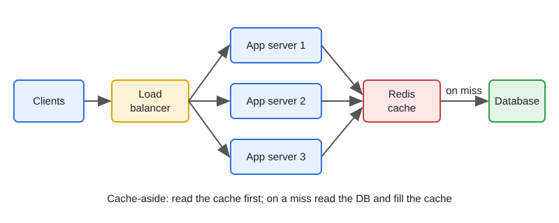
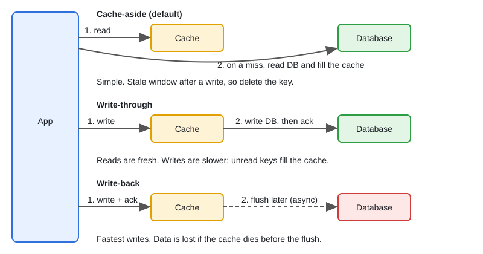

# Load Balancing and Caching Strategies

[← Section index](../README.md) · Prev: [Fundamentals: Scalability, Availability, Latency](../01-fundamentals-scalability-availability-latency/README.md) · Next: [Databases: SQL vs NoSQL, Indexing, Replication, Sharding](../03-databases-sql-nosql-indexing-replication-sharding/README.md)

**Interview weight: 1.2%**  ·  Revise in: 8 min

## In one line
A load balancer spreads requests across healthy backends, and a cache (usually cache-aside in Redis: the app checks the cache, loads from the DB on a miss) absorbs read load, at the price of stale data and stampedes you must handle.

## Must know
- L4 balances connections (fast, no routing). L7 sees HTTP/gRPC, so it can route by path or header, retry, and terminate TLS.
- Algorithms: round robin, weighted round robin, least connections, IP or consistent hash (affinity), power-of-two-choices (pick 2 at random, take the less loaded).
- Health checks: active probes plus passive outlier ejection. Readiness removes traffic; liveness restarts the pod.
- gRPC over a Kubernetes ClusterIP Service pins each client to one pod (one long HTTP/2 connection). Fix with a headless Service plus client-side round_robin, or an L7 proxy.
- Avoid sticky sessions; keep session state in Redis or a signed token.
- Patterns: cache-aside (default), read-through, write-around, plus write-through and write-back (see second diagram).
- Eviction: LRU (recency), LFU (frequency), TTL. Add TTL jitter (random extra expiry) so keys do not expire together.
- Stampede fix: one loader per key (singleflight), jitter, stale-while-revalidate (serve the old value while refreshing). Hot key fix: short-TTL in-process cache.

## Diagram

## Design in 5 steps
Example prompt: "cache a product catalogue read at high QPS". Numbers are illustrative.
1. **Requirements:** read-heavy, some staleness is fine (for example up to a few minutes), price changes should show quickly.
2. **Estimates:** say 50k reads/s peak. With a 95% hit ratio the DB sees about 2.5k reads/s. Working set = unique keys x value size.
3. **API + data model:** `GET /products/{id}`; key `v1:product:{id}`; value is the JSON blob.
4. **Architecture:** CDN for static assets, L7 LB, stateless app pods, Redis cache-aside, Postgres behind it. On write: commit to DB, then delete the key.
5. **Bottlenecks and trade-offs:** stampede on a hot key (singleflight, jitter), stale race after delete (short TTL, or invalidate from the DB change log, i.e. CDC), cache down (treat errors as misses, protect DB with a limit).

## Common traps
- Cache-aside race: a reader repopulates an old value just after the writer deletes the key. Bound it with TTL.
- Readiness probes that fail when the DB is down remove every pod at once.
- Caching "not found" or errors with a long TTL. Use a short TTL for negative entries.
- Unbounded caches, and keys with no version prefix (`v2:user:123`).

## Interview Q&A

**Q1. Why is only 1 of my 10 gRPC pods busy?**

**A:** kube-proxy balances per TCP connection, and gRPC multiplexes everything over one HTTP/2 connection. Use a headless Service with client-side round_robin, or an L7 proxy like Envoy that balances per request.

**Q2. What is a cache stampede and how do you stop it?**

**A:** A popular key expires and many concurrent misses all hit the DB. Collapse them with singleflight (`golang.org/x/sync/singleflight`, not stdlib), add TTL jitter, or serve stale while refreshing in the background.

**Q3. Cache-aside vs write-through?**

**A:** Cache-aside: app reads the cache, loads from DB on miss, deletes the key on write. Simple, but has a stale window. Write-through updates cache and DB together, so reads are fresh, but writes are slower and may fill the cache with unread keys.

**Q4. Why delete the cache key on write instead of updating it?**

**A:** Two concurrent writers can leave the older value last. Delete is idempotent and order-independent, and the next read reloads the truth.

**Q5. L4 vs L7 load balancer, which algorithm, and how do you handle a hot key?**

**A:** L4 is faster, L7 routes by path/header. Round robin for similar requests; least connections when request cost varies; consistent hash when you need affinity (cache locality); weighted for unequal servers. Hot key in Redis: add a short-TTL in-process cache, since more nodes do not help.

**Q6. What is cache penetration and how is it different from a stampede?**

**A:** Penetration is repeated requests for keys that do not exist (bad or malicious IDs), so every one misses and hits the DB. Fix with a short-TTL "not found" entry, ID validation, or a Bloom filter (compact set that says "definitely absent"). A stampede is one hot key expiring.
