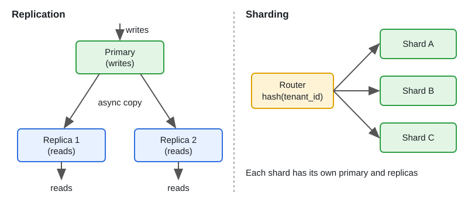
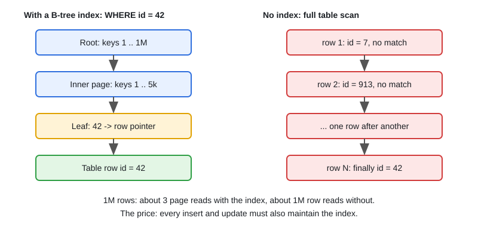

# Databases: SQL vs NoSQL, Indexing, Replication, Sharding

[← Section index](../README.md) · Prev: [Load Balancing and Caching Strategies](../02-load-balancing-and-caching-strategies/README.md) · Next: [CAP, Consistency Models & Consensus](../04-cap-consistency-models-consensus/README.md)

**Interview weight: 1.2%**  ·  Revise in: 10 min

## In one line
Start with Postgres, add indexes for measured queries, scale reads with replicas (and accept lag), and shard by a high-cardinality key (many distinct values) only when one primary cannot cope.

## Must know
- Pick the store by access pattern: Postgres (relations, ACID transactions), MongoDB (whole-document access), Cassandra (huge write volume, query by partition key), Neo4j (multi-hop traversals), Redis (small hot data).
- B-tree index: a tree lookup, O(log n), instead of a full scan (see second diagram). Good for point and range queries. Composite index follows the leftmost-prefix rule: equality columns first, range or sort column last.
- Every index costs extra work on each write. Check `EXPLAIN (ANALYZE)` and drop unused indexes.
- Postgres default isolation is Read Committed: non-repeatable reads and lost updates are possible. Use `SELECT ... FOR UPDATE`, a version column, or a stricter level.
- Optimistic locking: `UPDATE ... WHERE id=? AND version=?`; 0 rows affected means retry.
- Replication = copies for read scale and failover. Async: fast, but lag (replica behind the primary) gives stale reads and can lose data on failover. Sync replication: no data loss, slower writes.
- Read-your-writes with replicas: read from the primary for a short time after a write.
- Sharding = split data across primaries to scale writes and size. Hash is even but loses range scans; range keeps locality but gets hot on increasing keys. Cross-shard joins and transactions get hard.

## Diagram

## Design in 5 steps
Example prompt: "multi-tenant SaaS database". Numbers are illustrative.
1. **Requirements:** per-tenant data isolation, mostly reads, strong consistency for billing.
2. **Estimates:** say 2k writes/s and 20k reads/s. One Postgres primary plus replicas handles that; sharding is not needed yet.
3. **API + data model:** every table carries `tenant_id`; indexes start with `tenant_id`.
4. **Architecture:** primary for writes, async replicas for reads, PgBouncer (connection pooler), cache in front. Later: hash `tenant_id` into many logical partitions mapped to a few physical shards.
5. **Bottlenecks and trade-offs:** replication lag, a very large tenant hot-spotting one shard (pin it to its own shard), cross-tenant reports (copy to an analytics store).

## Common traps
- Sharding too early, or with a key that makes most queries cross-shard.
- Reading your own write from a lagging replica.
- Indexing a low-selectivity column such as `is_deleted`, or over-indexing a write-heavy table.
- Opening hundreds of pod connections straight to Postgres without a pooler.

## Interview Q&A

**Q1. SQL vs NoSQL: how do you choose?**

**A:** SQL for relations, joins, transactions and ad-hoc queries; one primary goes far. NoSQL when access patterns are known and simple and you need horizontal write scale or a flexible schema (Cassandra, DynamoDB) or document-shaped data (MongoDB). Cost: weaker joins and transactions.

**Q2. User saves settings, refreshes, sees old values. Why?**

**A:** The read hit an async replica that had not caught up. Route that user to the primary for a few seconds after a write, or wait until the replica reaches the write's log position.

**Q3. Replication vs sharding: what problem does each solve?**

**A:** Replication copies the same data to more nodes: scales reads and survives failures, not writes. Sharding splits data across nodes: scales writes and storage, but cross-shard queries get hard. Replicate first; shard when one primary cannot take the writes or the data.

**Q4. What is the leftmost-prefix rule?**

**A:** An index on `(a, b, c)` is sorted by a, then b, then c. It helps queries on `a`, `a,b`, or `a,b,c`, but not on `b` alone.

**Q5. Pick a shard key for a multi-tenant SaaS.**

**A:** `tenant_id`, so a tenant's queries stay on one shard. Hash it into many logical partitions for easy rebalancing. Whale tenants get a dedicated shard through a lookup table.

**Q6. What are the trade-offs of adding an index?**

**A:** Reads on the indexed columns get much faster; every insert and update gets slower because each index must be maintained, and indexes use disk and memory. Index columns used in WHERE, JOIN and ORDER BY with high selectivity, and confirm with `EXPLAIN`.

**Q7. Two users buy the last item at once. How do you stop overselling?**

**A:** Make the check and the change one atomic statement: `UPDATE stock SET qty = qty - 1 WHERE id = ? AND qty > 0` and treat 0 rows affected as sold out. Alternatives: `SELECT ... FOR UPDATE`, or a version column with retry.
