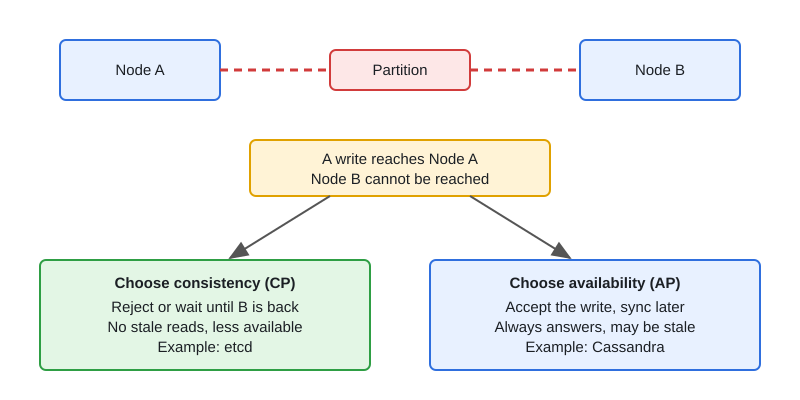

# CAP, Consistency Models & Consensus

[← Section index](../README.md) · Prev: [Databases: SQL vs NoSQL, Indexing, Replication, Sharding](../03-databases-sql-nosql-indexing-replication-sharding/README.md) · Next: [Message Queues: Kafka vs NATS vs GCP Pub/Sub](../05-message-queues-kafka-nats-pubsub/README.md)

**Interview weight: 1.0%**  ·  Revise in: 7 min

## In one line
During a network partition you must pick consistency or availability; quorums and consensus (Raft) are how systems make that choice safe, and sagas replace distributed transactions across services.

## Must know
- CAP: a partition is a network split between nodes. It will happen, so the real choice is C (consistent: every read sees the latest write) or A (available: every request gets an answer) while split. CP refuses or stalls; AP serves possibly stale data.
- PACELC: if Partition, choose A or C; Else (normal operation), choose Latency or Consistency. Cassandra leans AP and low latency by default.
- Consistency ladder, strong to weak: linearizable (behaves like one copy), sequential, causal, read-your-writes (session), eventual. Be able to place a system on it.
- Quorum: N replicas, write acked by W, read from R. If `W + R > N`, reads overlap the latest write. Typical: N=3, W=2, R=2.
- Raft: one leader per term, elected by majority vote with randomized timeouts. A write commits once a majority of nodes store it. 2F+1 nodes tolerate F failures.
- 2PC gives atomic commit but blocks if the coordinator dies. Fine inside one database cluster, poor across microservices.
- Saga: a chain of local transactions with compensating actions (undo steps, e.g. refund). Eventually consistent, so each step must be idempotent.
- Distributed locks can have two holders after a pause. Use a fencing token (a number that only grows); the resource rejects older tokens.

## Diagram

## Design in 5 steps
Example prompt: "keep order and payment services consistent". Illustrative only.
1. **Requirements:** no lost orders, no double charge. The user may see a short delay.
2. **Estimates:** low write volume, so correctness matters more than throughput.
3. **API + data model:** each request carries an idempotency key; an `outbox` table sits next to the orders table.
4. **Architecture:** order row and outbox row written in one local transaction; a relay publishes to the broker; an orchestrated saga calls payment, then inventory, with compensations (refund, release stock).
5. **Bottlenecks and trade-offs:** intermediate states are visible to users; payment path is CP-style, feeds and search are AP-style; unique values (order ID) come from one strongly consistent store.

## Common traps
- Saying "pick any two of C, A, P". P is not optional.
- Assuming `W + R > N` alone gives linearizability. It does not under concurrent writes without version ordering.
- Trusting a Redis lock for correctness without a fencing token.
- Using 2PC across autonomous services.

## Interview Q&A

**Q1. Is CAP "pick two of three"?**

**A:** No. Partitions are unavoidable, so during one you choose C or A. PACELC adds the latency vs consistency trade-off in normal operation.

**Q2. Why does `W + R > N` work?**

**A:** The set of replicas that acked the write and the set you read from must share at least one node, so the read sees the newest acknowledged version.

**Q3. Explain Raft leader election briefly.**

**A:** A follower with no heartbeat times out at a random time, becomes a candidate, bumps the term and asks for votes. A majority makes it leader. Randomized timeouts make repeated split votes unlikely.

**Q4. Saga or 2PC across services?**

**A:** Saga. Each service commits locally and publishes an event; a failure triggers compensations. 2PC would hold locks across services and block on a coordinator failure.

**Q5. Strong vs eventual consistency: when do you use each?**

**A:** Strong for money, inventory, unique IDs: stale reads are a bug. Eventual for feeds, likes, search, caches: replicas converge if writes stop, and you gain speed and availability. Read-your-writes (session) is a cheap middle ground.
