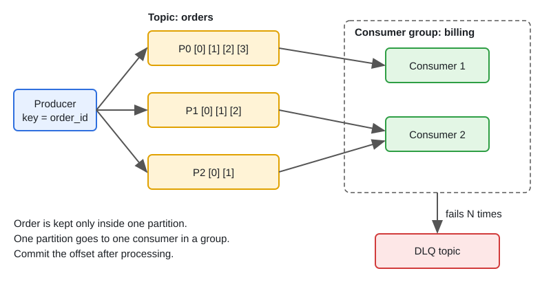

# Message Queues: Kafka vs NATS vs GCP Pub/Sub

[← Section index](../README.md) · Prev: [CAP, Consistency Models & Consensus](../04-cap-consistency-models-consensus/README.md) · Next: [Microservices Communication & Resilience](../06-microservices-communication-and-resilience/README.md)

**Interview weight: 1.2%**  ·  Revise in: 7 min

## In one line
Brokers decouple producers from consumers; every broker can redeliver, so consumers must be idempotent, and "exactly-once" is something you build end to end.

## Must know
- Kafka is a partitioned append-only log. Order is guaranteed only within a partition; the message key picks the partition.
- A partition is one ordered sub-log of a topic. A consumer group gives each partition to one consumer, so parallelism is at most the number of partitions. A rebalance (consumers join or leave) reassigns partitions and pauses processing briefly.
- Consumers track offsets (position in a partition). Commit after processing: a crash then means redelivery (at-least-once).
- Durability: `acks=all` plus `min.insync.replicas=2` (with replication factor 3) means the write is on at least 2 replicas before the ack.
- Kafka exactly-once covers Kafka-to-Kafka only. For DB or HTTP side effects, use an idempotent consumer (dedupe by message ID).
- NATS core is fast fire-and-forget (at-most-once). JetStream adds persistence, per-message acks and replay.
- GCP Pub/Sub: topic with many subscriptions, ack deadline with redelivery, optional ordering keys, dead-letter topics (DLQ: park messages that keep failing).
- Outbox pattern: write the business row and an outbox row in one DB transaction; a relay publishes it. This avoids the dual-write problem.

## Diagram

## Design in 5 steps
Example prompt: "order events from checkout to billing, email and analytics". Illustrative.
1. **Requirements:** no lost events, no double processing of side effects, per-order ordering.
2. **Estimates:** say 500 events/s peak. Pick partitions with headroom (for example 12), since adding them later changes key placement.
3. **API + data model:** event = `{event_id, order_id, type, payload}`; key = `order_id`.
4. **Architecture:** outbox relay to Kafka with `acks=all`; each downstream is its own consumer group; consumers commit after processing and dedupe on `event_id`; failures retry a few times, then go to a DLQ topic.
5. **Bottlenecks and trade-offs:** watch consumer lag, a hot key overloading one partition, rebalances, and DLQ depth. If low latency matters more than replay, NATS is an option; on GCP with no ops budget, Pub/Sub.

## Common traps
- Committing the offset before processing, which can lose messages on a crash.
- Expecting global ordering across partitions.
- Adding more consumers than partitions; extra ones sit idle.
- No DLQ, so one poison message blocks a partition forever.

## Interview Q&A

**Q1. How do you avoid duplicate processing?**

**A:** Assume at-least-once delivery. Give each event an ID and record processed IDs in the consumer's own DB, in the same transaction as the side effect. A replayed message then becomes a no-op.

**Q2. What do `acks=0/1/all` mean?**

**A:** 0: do not wait. 1: leader wrote it. all: all in-sync replicas wrote it. For durability use `all` with `min.insync.replicas` of 2 or more.

**Q3. How do you keep order and scale consumers in Kafka?**

**A:** Order holds only within a partition; use `order_id` as the key so one order's events share a partition. Scale by adding consumers up to the partition count. Beyond that, add partitions (changes key placement for new data) or use a worker pool per key.

**Q4. Kafka vs NATS?**

**A:** Kafka for durable, replayable, high-throughput event streams. NATS core for low-latency messaging where loss is acceptable; JetStream when you need persistence. Queues like RabbitMQ/SQS delete a message after ack; Kafka keeps the log for replay. Pick by delivery guarantee and ops cost.

**Q5. How do you handle a poison message?**

**A:** Retry a bounded number of times with backoff, then publish it to a DLQ topic with the error and attempt count. Alert on DLQ depth and keep a way to replay after a fix.

**Q6. At-most-once, at-least-once, exactly-once: what do they mean?**

**A:** At-most-once acks before processing: no duplicates, but messages can be lost. At-least-once acks after processing: no loss, but duplicates, and it is the usual default. Exactly-once is at-least-once plus an idempotent consumer, so the effect happens once.
