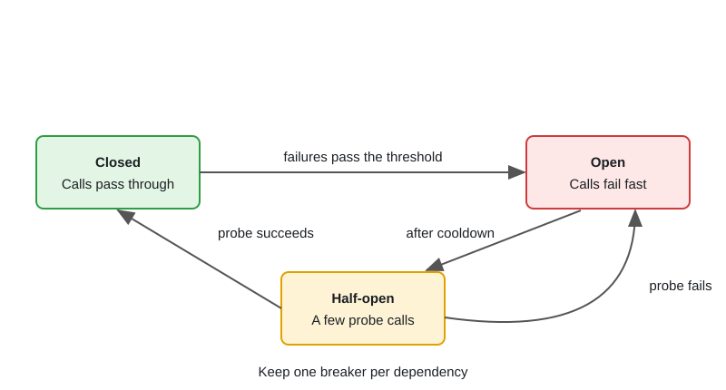

# Microservices Communication & Resilience

[← Section index](../README.md) · Prev: [Message Queues: Kafka vs NATS vs GCP Pub/Sub](../05-message-queues-kafka-nats-pubsub/README.md) · Next: [API Design: REST vs gRPC vs GraphQL & Versioning](../07-api-design-rest-grpc-graphql-versioning/README.md)

**Interview weight: 1.2%**  ·  Revise in: 8 min

## In one line
Every network call can fail or hang, so give each one a timeout, retry only safe operations with backoff, trip a circuit breaker on sustained failure, and make writes idempotent.

## Must know
- Sync (REST/gRPC) when the caller needs the answer now; async events for fan-out and anything that tolerates delay.
- Timeout on every call, propagated with `context`. Each hop gets less time than the one above it.
- Retry only transient errors (timeout, 503, `UNAVAILABLE`) on idempotent operations (safe to repeat). Use exponential backoff with jitter and a cap on attempts.
- Circuit breaker: closed (normal), open (fail fast after repeated failures), half-open (let a probe through after a cooldown). Keep one per dependency.
- Bulkhead: separate pools or semaphores (concurrency caps) per dependency so a slow one cannot starve the rest.
- Idempotency key: client sends a unique key; server stores the result and returns it on a repeat, so a retried charge happens once.
- Saga with compensations for cross-service workflows; outbox to publish events reliably (see topic 17).
- A service mesh (Istio, Linkerd) gives mTLS, retries and outlier detection without app code, but you still need idempotency in the app.

## Diagram

## Design in 5 steps
Example prompt: "Checkout calls Payment and Payment gets slow". Illustrative.
1. **Requirements:** checkout stays responsive, no double charge, clear message to the user on failure.
2. **Estimates:** if checkout has a 2 s budget, give Payment a smaller slice (for example under 1 s), so a retry still fits.
3. **API + data model:** `POST /payments` with an `Idempotency-Key` header; server table `key -> request hash, status, response`.
4. **Architecture:** an overall deadline; retry with backoff and jitter around a circuit breaker; a bulkhead capping concurrent calls to Payment. When the breaker is open, return a fallback such as "payment processing" and queue the work.
5. **Bottlenecks and trade-offs:** retries can multiply load during an outage (cap them); a fallback is a product decision; alert on breaker state and p99.

## Common traps
- Retrying non-idempotent calls, or retrying with no jitter so every client retries together.
- No timeout, so goroutines and connections pile up and the failure cascades upstream.
- One shared connection pool for all dependencies.
- Relying on the mesh to retry while the handler is not idempotent.

## Interview Q&A

**Q1. Why add jitter to retries?**

**A:** Clients that failed together would otherwise retry together, creating waves. Random delay spreads the load. Also cap attempts and respect `Retry-After`.

**Q2. Which wraps which, retry or circuit breaker?**

**A:** Retry calls through the breaker. Each attempt counts as a breaker call, so persistent failure opens the circuit and retries stop quickly.

**Q3. Checkout calls a slow Payment service. What do you do?**

**A:** Add a deadline and a concurrency limit for Payment, wrap it in a breaker, retry only with an idempotency key, and degrade gracefully (queue the payment, show "processing") when the breaker is open.

**Q4. How do you design the idempotency key store?**

**A:** Atomic set-if-absent on `(user, key)` (Redis `SET NX` or a unique DB index). Store a hash of the request body and the response. Same key with a different body is rejected. Expire entries after a retention window.

**Q5. Sync or async between services?**

**A:** Sync when the caller needs the answer now (price check). Async via a broker for fan-out, traffic spikes and slow work: it decouples and buffers, but is eventually consistent and harder to debug.
