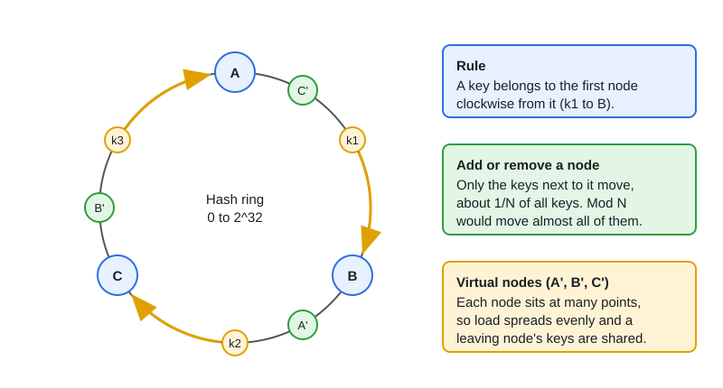

# Consistent Hashing & Distributed Cache

[← Section index](../README.md) · Prev: [API Design: REST vs gRPC vs GraphQL & Versioning](../07-api-design-rest-grpc-graphql-versioning/README.md) · Next: [Design: Rate Limiter](../09-design-rate-limiter/README.md)

**Interview weight: 0.7%**  ·  Revise in: 5 min

## In one line
Consistent hashing places keys and nodes on a ring so that adding or removing a node moves only about 1/N of the keys, instead of nearly all of them as with `hash % N`.

## Must know
- Hash nodes and keys onto the same ring. A key belongs to the first node clockwise from it.
- With `hash % N`, changing N remaps almost every key, which causes a wave of cache misses. On a ring only the neighbouring range moves.
- Virtual nodes: each physical node appears at many points on the ring. This evens out load and lets a bigger node take more points.
- Redis Cluster uses fixed slots instead: `CRC16(key) % 16384` picks a slot, and each slot belongs to a node. Moving a slot moves its keys.
- Each Redis primary can have replicas that take over on failure.
- Redis vs Memcached: Redis has data structures, persistence, pub/sub and clustering. Memcached is a simpler multi-threaded pure cache.
- A single hot key still lands on one node, so adding nodes does not fix it.

## Diagram

## Design in 5 steps
Example prompt: "design a distributed cache". Numbers are illustrative.
1. **Requirements:** low-latency get/set, survive node loss, add capacity without a cache wipe.
2. **Estimates:** say 100M keys x 1 KB = about 100 GB. At about 16 GB per node that is roughly 7-8 nodes with headroom.
3. **API + data model:** `GET`, `SET key ttl`, `DEL`; value is an opaque blob; TTL per key.
4. **Architecture:** clients (or a proxy) hash the key on a ring with virtual nodes; each shard has a replica; LRU eviction (drop least recently used) when memory is full.
5. **Bottlenecks and trade-offs:** hot keys (local cache or key replication), stampede on expiry (many misses at once; jitter, one loader per key), replica lag means stale reads.

## Common traps
- Using `hash % N` for a cache that will be resized.
- Too few virtual nodes, which gives uneven load.
- Treating a cache as the source of truth.
- Expecting more nodes to fix one hot key.

## Interview Q&A

**Q1. Why virtual nodes?**

**A:** With one point per node, ring gaps are uneven and some nodes carry far more keys. Many virtual points per node average this out and ease rebalancing when a node leaves.

**Q2. How much moves when you add a node?**

**A:** About 1/N of the keys, taken from neighbouring nodes. With `hash % N` nearly all keys move.

**Q3. A cache node dies. What happens to its keys and to the database?**

**A:** Its keys move to the next nodes on the ring, so those keys miss and the DB sees a spike. Virtual nodes spread that load over many nodes; replicas avoid the misses. Protect the DB with a limit.

**Q4. How does Redis Cluster route a key?**

**A:** `CRC16(key) % 16384` gives a slot, and the cluster maps slots to nodes. Clients cache that map and follow redirects when it changes.

**Q5. Redis or Memcached?**

**A:** Redis when you need data structures, persistence or replication. Memcached for a plain, simple cache.
