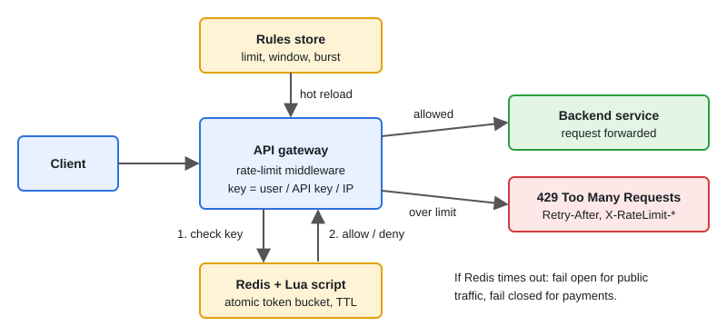

# Design: Rate Limiter

[← Section index](../README.md) · Prev: [Consistent Hashing & Distributed Cache](../08-consistent-hashing-and-distributed-cache/README.md) · Next: [Design: URL Shortener](../10-design-url-shortener/README.md)

**Interview weight: 1.0%**  ·  Revise in: 8 min

## In one line
A rate limiter keeps a small counter or token bucket per key (user, API key, IP) in a shared store like Redis, updates it atomically, and returns 429 with `Retry-After` when the key is over its limit.

## Must know
- Ask first: limit per user, key or IP? One region or global? Fail open (allow traffic) or fail closed (block)?
- Token bucket: refill by elapsed time, allows bursts, O(1) memory. Default choice.
- Fixed window: simplest, but up to 2x the limit can pass across a window edge.
- Sliding window counter: estimate = current count + previous count x overlap share, O(1), good for "N per minute".
- Sliding log: exact, but stores every timestamp, so memory grows under attack.
- Atomicity: many gateways share one key, so use `INCR` or a Redis Lua script. Plain GET, compute, SET races.
- Response: 429, `Retry-After`, and `X-RateLimit-Limit/Remaining/Reset` headers.
- Redis down: fail open for public traffic, fail closed for payments. Always alert.

## Diagram

## Design in 5 steps
1. **Requirements:** per-key limit, rule per plan, hot-reloadable rules, very low added latency, no single point of failure.
2. **Estimates (illustrative):** say 100k requests/s at peak and 2M active keys. A token bucket is two numbers per key (tokens, last time), so memory is small. One Redis round trip per request is the real cost.
3. **API + data model:** `Allow(key, rule) -> allowed, remaining, retryAfter`. Rules table: `(key_type, endpoint, limit, window, burst)`. Redis key `rl:{tenant}:{user}:{endpoint}` with a TTL about equal to the refill time.
4. **Architecture:** gateway middleware builds the key, looks up the rule in memory, runs the Lua script on Redis, then forwards or returns 429. Rules live in a config store and are pushed to the gateways.
5. **Bottlenecks/trade-offs:** Redis latency (use a short timeout, or a local bucket that syncs now and then), hot keys (split into sub-keys), multi-region (split the budget per region), accuracy vs speed.

## Common traps
- Read-modify-write from Go code without a script or atomic command, so two gateways both allow.
- Using client clocks. Use one time source (Redis `TIME`) or keep the math inside the script.
- Fixed window with no mention of the boundary burst.
- Clients retrying at the same moment when the window resets. Tell clients to add jitter.

## Interview Q&A

**Q1. Token bucket vs leaky bucket?**

**A:** Both enforce an average rate. Token bucket allows bursts up to its capacity and rejects fast. Leaky bucket smooths output to a steady rate by queueing.

**Q2. How do you make the check atomic across servers?**

**A:** Run it as one Redis command or Lua script, since Redis runs a script without interleaving other commands. In Redis Cluster, keep multi-key scripts on one slot with hash tags.

**Q3. What if Redis is down?**

**A:** Decide per endpoint. Public reads fail open with a conservative local fallback bucket. Money-moving endpoints fail closed. Alert either way.

**Q4. Which rate-limiting algorithm would you pick, and how do you handle a hot key?**

**A:** Token bucket by default: allows bursts, O(1) memory. Sliding window counter if bursts must be smoothed at window edges. Fixed window only when approximate is fine. Avoid sliding log at scale. Hot key: split into k sub-keys of limit/k.

**Q5. Where does the limiter live?**

**A:** Gateway for coarse per-IP or per-key limits, service middleware for business limits. Both can use the same Redis.
