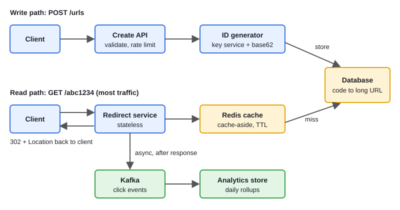

# Design: URL Shortener

[← Section index](../README.md) · Prev: [Design: Rate Limiter](../09-design-rate-limiter/README.md) · Next: [Design: Notification System](../11-design-notification-system/README.md)

**Interview weight: 1.2%**  ·  Revise in: 8 min

## In one line
A URL shortener maps a short unique code to a long URL: writes generate a code and store it, reads hit a cache first and answer with a 302 redirect, and click analytics are sent asynchronously.

## Must know
- Read-heavy: far more redirects than creations, so cache hot codes and keep the redirect path tiny.
- Code length: base62 (a-z, A-Z, 0-9) with 7 characters gives 62^7, about 3.5 trillion codes. Plenty.
- ID options: counter encoded in base62 (easy but guessable), hash of URL (collisions, needs a check), random + retry on conflict, Snowflake-style ID, or a pre-generated key service.
- Snowflake layout: 41 bits time, 10 bits machine, 12 bits sequence. Needs care when the clock moves backwards. In base62 it is about 11 characters, longer than 7.
- 302 keeps analytics and lets you edit links. 301 is cached by browsers, so less load but lost clicks.
- Cache-aside in Redis with a TTL (on a miss read the DB and fill the cache), plus negative caching (briefly cache "not found").
- Never update a click counter on the main row. Publish events to a queue and aggregate later.
- Check `expires_at` on read (return 410) and delete expired rows in small batches.

## Diagram

## Design in 5 steps
1. **Requirements:** create short URL, redirect, optional custom alias and expiry, basic click stats. Redirects must be fast and highly available.
2. **Estimates (illustrative):** say 100M new URLs a month and a 100:1 read:write ratio. That is roughly 40 writes/s and 4,000 reads/s on average. Rows are a few hundred bytes, so a few TB over five years.
3. **API + data model:** `POST /urls {long_url, alias?, expires_at?}` returns the short URL. `GET /{code}` returns 302 with `Location`. Table `urls(code PK, long_url, user_id, created_at, expires_at)`. A key-value store or sharded SQL both work.
4. **Architecture:** load balancer, stateless redirect service, Redis cache, database, ID generator for writes, queue for click events feeding an analytics store.
5. **Bottlenecks/trade-offs:** ID generation without collisions, cache hit ratio, a viral link on a cold cache (coalesce: one DB lookup, other requests wait for it), abuse and malicious links (rate limit creation, blocklist), single DB write point (shard by code).

## Common traps
- Sequential IDs: anyone can walk through all links, and one writer becomes a bottleneck.
- Truncated hashes without a collision check.
- Counting clicks with `UPDATE ... SET clicks = clicks + 1` on the hot row.
- Choosing 301 and then wondering why analytics are wrong.

## Interview Q&A

**Q1. How do you count clicks without slowing the redirect?**

**A:** Respond first, then publish a click event (code, time, country, user agent) to a queue. A consumer aggregates into an analytics store, so counts are eventually consistent.

**Q2. How do you generate unique short codes across many servers?**

**A:** A key generation service hands each server a batch of unused codes, or each server gets a counter range and base62-encodes it. For random codes, insert and retry on a unique-key conflict. A custom alias uses the same unique-key check.

**Q3. 301 or 302?**

**A:** 302 if you want every click counted and links editable. 301 only if reducing load matters more than analytics.

**Q4. How do you make redirects fast?**

**A:** Redis cache-aside in front of the DB, optionally a CDN for the hottest links, and no analytics work on the request path.

**Q5. How do you scale the database?**

**A:** Reads are mostly served by cache and replicas. For writes, shard by hash of the code.
