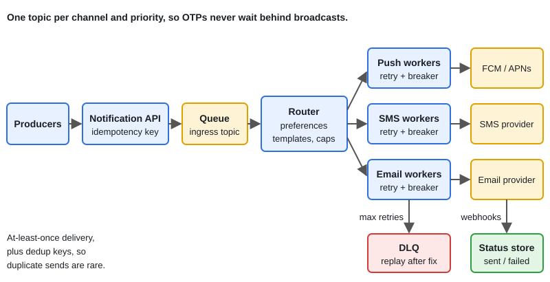

# Design: Notification System

[← Section index](../README.md) · Prev: [Design: URL Shortener](../10-design-url-shortener/README.md) · Next: [Design: Distributed Job Scheduler](../12-design-distributed-job-scheduler/README.md)

**Interview weight: 0.8%**  ·  Revise in: 7 min

## In one line
A notification system accepts events from services, queues them per channel and priority, checks user preferences, sends through providers with retries, and avoids duplicate sends.

## Must know
- Channels: push, SMS, email (maybe in-app). Each has its own workers and provider adapter.
- Queue between API and workers absorbs bursts. One topic per channel and priority (a queue is FIFO, a priority field alone does not reorder it), so OTPs never wait behind marketing.
- Delivery is at-least-once, so dedupe: an idempotency key at the API, plus a "already sent" key before calling the provider.
- Retries: only for retryable errors (timeouts, 429, 5xx), exponential backoff with jitter, then a dead-letter queue (DLQ).
- Never sleep inside a queue consumer to wait for a retry. Publish to a delay topic or scheduler instead.
- Provider limits: a token bucket per provider, a circuit breaker, and a backup provider.
- Preferences and consent (opt-out, quiet hours, frequency caps) are checked before sending.
- Broadcast to millions: send batches of user ids through the queue, not one message per user from one loop.

## Diagram

## Design in 5 steps
1. **Requirements:** channels, transactional vs marketing, scheduling, preferences, delivery status. No duplicate messages to users.
2. **Estimates (illustrative):** say 10M notifications a day averages about 115/s, but a broadcast can spike to thousands per second. Size for the spike, not the average.
3. **API + data model:** `POST /notifications {user_id, channel, template, data, priority, idempotency_key}`. Tables or stores: user preferences, device tokens, templates, notification status per user.
4. **Architecture:** API, ingress queue, router (preferences, template rendering), per-channel queues, workers with provider adapters, status store, DLQ.
5. **Bottlenecks/trade-offs:** provider rate limits, duplicate vs lost message (pick one per channel), retry storms, broadcast fan-out, ordering (rarely needed).

## Common traps
- Retrying on a terminal error such as an invalid device token.
- One shared queue where a marketing blast delays OTPs.
- Ignoring that the worker can crash after the provider accepted the message but before it acknowledges.
- Sending without checking opt-out.

## Interview Q&A

**Q1. How do you avoid sending the same SMS twice?**

**A:** Idempotency key at the API, a send-guard key per (notification, channel) checked before calling the provider, and provider reference ids if offered. A tiny window remains, so decide whether a rare duplicate or a rare loss is worse for that channel.

**Q2. How do you retry without blocking the queue?**

**A:** Ack the original and publish to a delay topic or scheduler. After max attempts, move it to the DLQ.

**Q3. A provider is failing. What now?**

**A:** The circuit breaker opens and traffic goes to the backup provider. Low priority messages are shed first.

**Q4. How do you send to a very large audience?**

**A:** Read the segment in pages, publish batches of ids, expand them in parallel workers on low-priority topics, and checkpoint progress so the job can resume.

**Q5. How do you know a message was delivered, not just sent?**

**A:** The provider first accepts it ("sent"). Later it calls a webhook with delivered, failed or bounced, and you update the status by provider reference id. Sent is not delivered.
