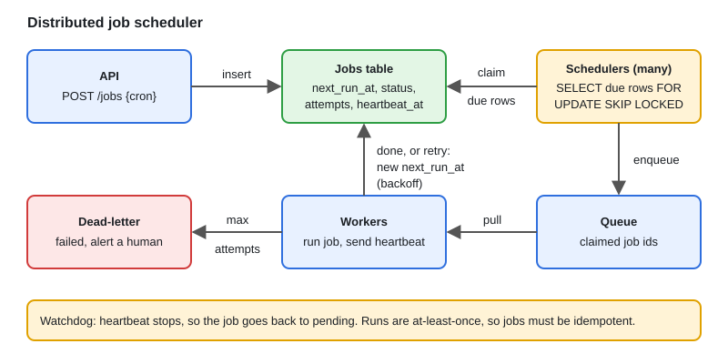

# Design: Distributed Job Scheduler

[← Section index](../README.md) · Prev: [Design: Notification System](../11-design-notification-system/README.md) · Next: [Design: Multi-Cloud Resource Discovery Platform](../13-design-multi-cloud-resource-discovery-platform/README.md)

**Interview weight: 0.7%**  ·  Revise in: 5 min

## In one line
A job scheduler stores jobs with a next run time, finds due jobs, hands each to one worker at a time, and requeues work if a worker dies, giving at-least-once execution.

## Must know
- Jobs: one-time or recurring (cron). Store `next_run_at` and update it after each run.
- Job store: SQL table with an index on `(status, next_run_at)`. Redis or a queue also works.
- Claiming a job: in one transaction, `SELECT ... FOR UPDATE SKIP LOCKED` then set `status=running, locked_by`. Many schedulers pick different rows without blocking.
- Alternative: one leader scheduler (lease in etcd or Redis) scans for due jobs. Simpler, but needs failover.
- Execution is at-least-once, so jobs must be idempotent (use an idempotency key or check before acting).
- Overlap: decide per job whether a slow run may overlap the next one, or the next run waits.
- Retry with backoff and a max attempt count, then mark failed and alert.

## Diagram

## Design in 5 steps
1. **Requirements:** one-time and cron jobs, at-least-once, scale out, visibility into job state.
2. **Estimates (illustrative):** say 1M scheduled jobs and 1,000 due per second at peak. A single indexed table handles scanning, workers do the heavy part.
3. **API + data model:** `POST /jobs {cron, payload}`. Table `jobs(id, payload, cron, next_run_at, status, attempts, locked_by, heartbeat_at)`.
4. **Architecture:** API, job store, scheduler(s) claiming due rows, queue, worker pool, result store.
5. **Bottlenecks/trade-offs:** DB polling load (index it, batch claims), clock skew (use DB time), duplicate runs vs missed runs, poison jobs.

## Common traps
- Two schedulers running the same job because the claim was not atomic.
- Assuming exactly-once. Design for at-least-once plus idempotency.
- Starting the next run while the previous is still going, so slow jobs pile up.

## Interview Q&A

**Q1. How do you stop two schedulers from running the same job?**

**A:** Claim rows atomically with `FOR UPDATE SKIP LOCKED`, or use a single leader with a lease or a lock with a TTL.

**Q2. A job runs longer than its interval. What happens?**

**A:** Either skip or delay the next run until the current one finishes, or allow a limited number of concurrent runs. Make it a per-job setting.

**Q3. A job was due while the scheduler was down. What happens on restart?**

**A:** Set a misfire policy per job: run once now to catch up, or skip to the next slot. Do not blindly replay every missed run.

**Q4. What if a worker crashes mid-job?**

**A:** The heartbeat times out, the watchdog sets the job back to pending, and another worker retries it. The job must be safe to run twice.

**Q5. How do you scale it?**

**A:** Add workers behind the queue, partition jobs by type or tenant, and let several schedulers claim batches.

**Q6. What do you do with a job that keeps failing?**

**A:** Retry only retryable errors with exponential backoff and a max attempt count, then move it to a dead-letter state and alert. Otherwise a poison job wastes capacity forever.
