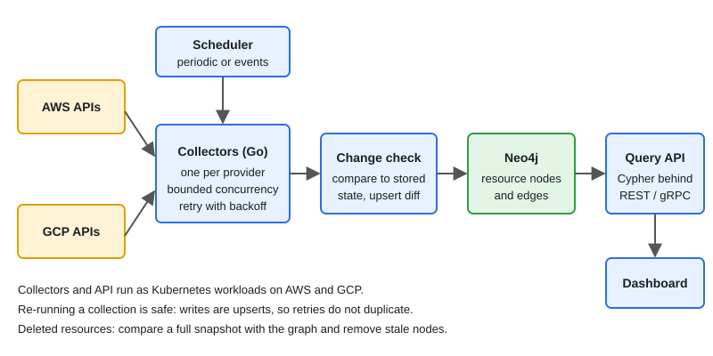

# Design: Multi-Cloud Resource Discovery Platform

[← Section index](../README.md) · Prev: [Design: Distributed Job Scheduler](../12-design-distributed-job-scheduler/README.md) · Next: [Design: Chat System & WebSockets](../14-design-chat-system-websockets/README.md)

**Interview weight: 1.3%**  ·  Revise in: 10 min

## In one line
My platform, written in Go, discovers infrastructure across cloud providers using collectors, stores resources and their relationships as a graph in Neo4j, and serves queries about that graph; it runs on Kubernetes on AWS and GCP.

## Must know
- This is your own project. Replace anything below that differs from what you built, and be ready to say what YOU did.
- Problem: teams cannot see what exists across several cloud accounts and how resources connect.
- Collectors call provider APIs per account, normalize results into one resource model, and push them to the graph.
- Neo4j (graph database, queried with Cypher) fits because the questions are about relationships: what connects to what, what depends on what, how far.
- Change detection: compare new data with stored state and write only differences, to cut load on the graph.
- Concurrency in Go: goroutines with a bounded worker pool per provider, context for cancel and timeouts, retry with backoff.
- Provider API rate limits are the main external constraint: limit per account, back off on throttling.
- Deleted resources: stamp `last_seen` on each upsert; remove what a fully successful collection no longer sees. Never delete after a partial run.

## Diagram

## Design in 5 steps
1. **Requirements:** discover resources across providers, keep the graph reasonably fresh, answer relationship queries, collect safely (read-only access).
2. **Estimates (illustrative, use your real numbers):** `[your number]` accounts, `[your number]` resources, refresh every `[your interval]`. Count API calls per refresh and compare with provider rate limits.
3. **API + data model:** nodes are resources (type, id, region, account, properties); edges are relationships such as "contained in" or "attached to". Query API wraps Cypher behind REST or gRPC.
4. **Architecture:** scheduler triggers collectors, collectors fetch and normalize, change check upserts into Neo4j, query API reads the graph, services run as Kubernetes workloads on AWS and GCP.
5. **Bottlenecks/trade-offs:** API rate limits, graph write volume, partial failures (idempotent upserts, retry), stale data vs freshness cost, credentials per account.

## Common traps
- Claiming numbers you did not measure. Say "I don't have the exact figure" if unsure.
- Describing the stack but not why: always give the reason (graph for relationships, Go for concurrent collection).
- Forgetting deletes: a graph only grows unless you reconcile.
- No story for failure: what happens if one provider or account fails mid-run?

## Interview Q&A

**Q1. Why a graph database instead of SQL?**

**A:** The core queries traverse relationships of varying depth, such as dependencies or connected resources. In a graph that is a natural traversal, in SQL it becomes many joins.

**Q2. How do you handle cloud API rate limits?**

**A:** Limit request rate per account, retry throttled calls with exponential backoff and jitter, and bound concurrency with a worker pool.

**Q3. How do you handle deleted resources and a failed collection run?**

**A:** Writes are upserts, so rerunning is safe. Nodes get `last_seen`; delete only nodes unseen in a scope (account + region) whose collection fully succeeded, otherwise a failed run would wipe valid data. Provider delete events can speed this up.

**Q4. How would you scale it?**

**A:** Shard collection work by account and region across more collector pods, and scale the query API separately.

**Q5. How do you access many cloud accounts safely?**

**A:** Read-only roles per account, assumed with short-lived credentials (for example AWS STS or GCP workload identity), so no long-lived keys are stored. Scope each collector to its own accounts.

**Q6. What are the weaknesses of this design?**

**A:** Data is only as fresh as the refresh interval (events would help). Graph stores usually shard less easily than SQL or key-value stores, and every new provider needs its own normalization. Add what you would change: `[your lesson]`.
