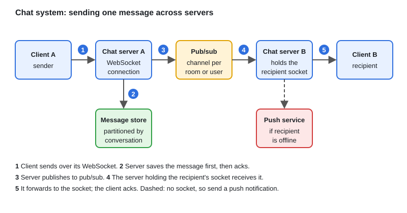

# Design: Chat System & WebSockets

[← Section index](../README.md) · Prev: [Design: Multi-Cloud Resource Discovery Platform](../13-design-multi-cloud-resource-discovery-platform/README.md) · Next: [Design: Metrics, Monitoring & Alerting System](../15-design-metrics-monitoring-alerting-system/README.md)

**Interview weight: 0.6%**  ·  Revise in: 5 min

## In one line
Clients keep a WebSocket to a chat server, messages are saved first and then fanned out through a pub/sub layer to the servers holding the recipients' connections, and offline users get a push notification.

## Must know
- WebSocket: one long-lived two-way connection per client. SSE (Server-Sent Events) is server-to-client only. Long polling (server holds a request open until data arrives) is a fallback.
- A chat server keeps a map of user id to connection. With many servers, you need to know which server holds a user.
- Persist the message before acknowledging it. Use a write-heavy store partitioned by conversation.
- Ordering: a per-conversation sequence or time-ordered ID. Clients sort by it.
- Presence: heartbeats with a TTL key. No heartbeat means offline.
- Reconnect: client sends the last message id it saw, server returns what came after.
- Delivery receipts: client acks, server marks delivered.

## Diagram

## Design in 5 steps
1. **Requirements:** 1:1 and group chat, history, presence, receipts, low latency.
2. **Estimates (illustrative):** say 1M concurrent connections. At tens of thousands of connections per server that means dozens of servers, so cross-server routing is unavoidable.
3. **API + data model:** WebSocket events `send`, `ack`, `typing`; REST for history. Table `messages(conversation_id, message_id, sender_id, body, ts)` partitioned by conversation.
4. **Architecture:** load balancer, chat servers, pub/sub, message store, presence store, notification service for offline users.
5. **Bottlenecks/trade-offs:** connection count per server, very large groups (fan-out cost), ordering across servers, at-least-once delivery with client dedup by message id.

## Common traps
- Sending first and saving later, so a crash loses messages.
- Keeping connection state only in memory with no way to find the right server.
- Ignoring that sockets are long-lived: balance by least connections, and add jitter to reconnects so a restart does not cause a storm.

## Interview Q&A

**Q1. WebSocket, SSE or long polling?**

**A:** WebSocket for two-way chat. SSE if only the server pushes. Long polling when WebSockets are blocked.

**Q2. How does a message reach a user on another server?**

**A:** The sender's server publishes to pub/sub; the server holding the recipient's socket (found via a user-to-server map in Redis, or a per-user channel) forwards it.

**Q3. How do you keep chat messages in order?**

**A:** The server that persists a message assigns a per-conversation sequence number, with one writer per conversation (partition by conversation id). Clients sort by it, not by client clocks.

**Q4. How do you replay missed messages?**

**A:** The client sends its last seen message id on reconnect and the server queries the store for newer messages.

**Q5. How do you detect who is online?**

**A:** Periodic heartbeats refresh a key with a TTL. When it expires, the user is offline.

**Q6. How do you deliver to a group with 100,000 members?**

**A:** Store the message once per group and publish once; each server delivers to its local members. Offline members pull on reconnect, and very large groups can use pull instead of push.

**Q7. Can a message be lost or delivered twice?**

**A:** Saving before acking means a crash makes the sender retry, so delivery is at-least-once. The client generates a message id and the server and receiver dedupe on it.
