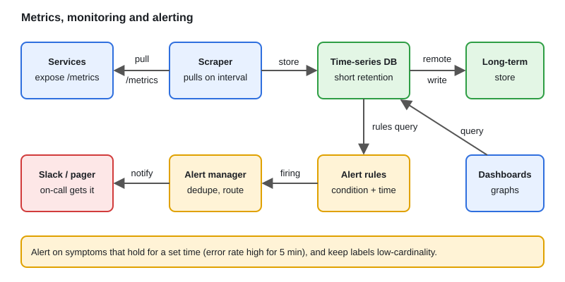

# Design: Metrics, Monitoring & Alerting System

[← Section index](../README.md) · Prev: [Design: Chat System & WebSockets](../14-design-chat-system-websockets/README.md) · Next: [System Design Interview Framework & Checklist](../16-system-design-interview-framework-and-checklist/README.md)

**Interview weight: 0.5%**  ·  Optional / low priority  ·  Revise in: 4 min

## In one line
Services expose metrics, a collector scrapes them into a time-series database, dashboards query it, and alert rules fire notifications when a condition holds for a set time.

## Must know
- Pull (Prometheus scrapes endpoints) vs push (short batch jobs push to a gateway).
- Time-series DB stores `(metric, labels, timestamp, value)`. Long-term storage downsamples old data.
- Cardinality: every unique label combination is a series. Labels like user id explode memory.
- Alerts: a rule must hold for a set time before it fires. The alert manager routes and deduplicates.
- RED for services (rate, errors, duration). USE for resources (utilization, saturation, errors).
- Three pillars: metrics, logs, traces.

## Diagram

## Design in 5 steps
1. **Requirements:** ingest many metrics, query fast, alert reliably, dashboards.
2. **Estimates (illustrative):** series count times scrape interval gives samples per second. Keep labels low-cardinality.
3. **API + data model:** a `/metrics` endpoint per service; samples keyed by metric name and labels.
4. **Architecture:** services, scraper, TSDB, long-term storage, dashboards, alert manager, paging/chat.
5. **Bottlenecks/trade-offs:** cardinality, retention vs cost, HA for the monitor itself.

## Common traps
- Putting unbounded values (user id, request id) in labels.
- Alerting on causes instead of symptoms, causing noise.

## Interview Q&A

**Q1. What is cardinality and why does it matter?**

**A:** The number of unique label combinations. High cardinality means huge numbers of series and memory pressure.

**Q2. Pull or push?**

**A:** Pull is simple and shows when a target is down. Push suits short-lived jobs.

**Q3. How do you scale metric collection and storage?**

**A:** Shard scrapers by target set, keep labels low-cardinality, keep short retention locally, and send samples to a long-term store for history and global queries.

**Q4. How do you make monitoring highly available?**

**A:** Run redundant instances and deduplicate, and send alerts through a separate path.

**Q5. How do you keep alerts useful and not noisy?**

**A:** Alert on symptoms users feel (error rate, latency), not causes like CPU. Require the condition for a time window, group and deduplicate, and give each alert an owner and a runbook.
