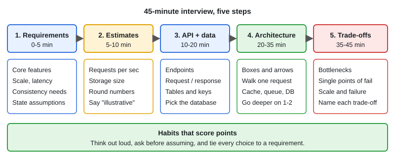

# System Design Interview Framework & Checklist

[← Section index](../README.md) · Prev: [Design: Metrics, Monitoring & Alerting System](../15-design-metrics-monitoring-alerting-system/README.md) · Next: [Distributed Design Patterns](../17-distributed-design-patterns/README.md)

**Interview weight: 1.3%**  ·  Revise in: 8 min

## In one line
Spend the 45 minutes on five steps: requirements, estimates, API and data model, architecture, then bottlenecks and trade-offs, while talking out loud.

## Must know
- Ask clarifying questions first and state your assumptions. Do not start drawing at once.
- Separate functional requirements (what it does) from non-functional (scale, latency, availability, consistency).
- Estimates are rough and rounded. Their job is to show whether you need sharding, caching or a queue.
- Define the API and the main tables before the architecture.
- Draw the simplest design that works, walk one request through it, then deepen 1-2 areas.
- Every choice has a trade-off. Name it (consistency vs availability, latency vs cost, simple vs scalable).
- Interviewers want to hear failure thinking: what breaks, how you detect it, how you recover.
- Start simple (one DB, one service) and scale only where the numbers say so.

## Diagram

## Design in 5 steps
1. **Requirements (0-5 min):** users, core features, scale, latency, consistency needs, what is out of scope.
2. **Estimates (5-10 min):** requests per second, storage, read:write ratio. Round numbers, label them illustrative. A day is about 100k seconds, so 1M requests a day is about 10/s.
3. **API + data model (10-20 min):** endpoints with inputs and outputs, tables or keys, choice of database and why.
4. **Architecture (20-35 min):** load balancer, services, cache, queue, database, then one request end to end.
5. **Bottlenecks/trade-offs (35-45 min):** single points of failure, hot keys, replication, caching and invalidation, monitoring, and what you would do next.

## Common traps
- Jumping into components before asking about scale and requirements.
- Buzzword stacking (Kafka, Redis, Cassandra) with no reason tied to a requirement.
- Silent thinking. Say your reasoning out loud.
- Ignoring the interviewer's hints when they steer you to a deep dive.

## Interview Q&A

**Q1. What do you check at the end of a design?**

**A:** Single points of failure, write spikes (queue in front), hot partitions, data loss (replication, backups), cache invalidation, idempotent APIs, observability, security.

**Q2. Rough latency numbers to remember?**

**A:** Memory access is about 100 ns, an SSD random read about 100 microseconds, a round trip inside a data center about 0.5 ms, and across regions about 100+ ms. Treat them as orders of magnitude.

**Q3. How do you choose between consistency and availability?**

**A:** Ask what a stale or failed answer costs. Payments lean to consistency, feeds and counters can accept eventual consistency.

**Q4. How do you design for high availability?**

**A:** Remove single points of failure with replicas and load balancing, use health checks and failover, degrade gracefully, and test failure paths.
