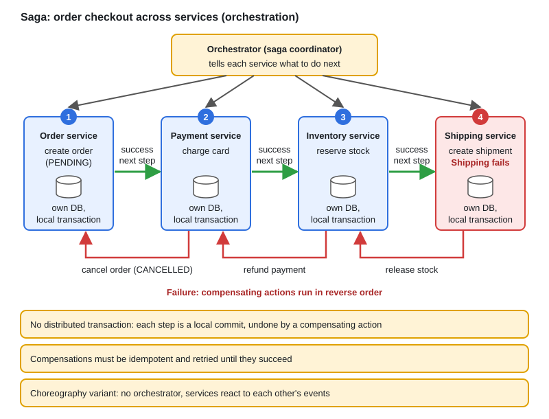
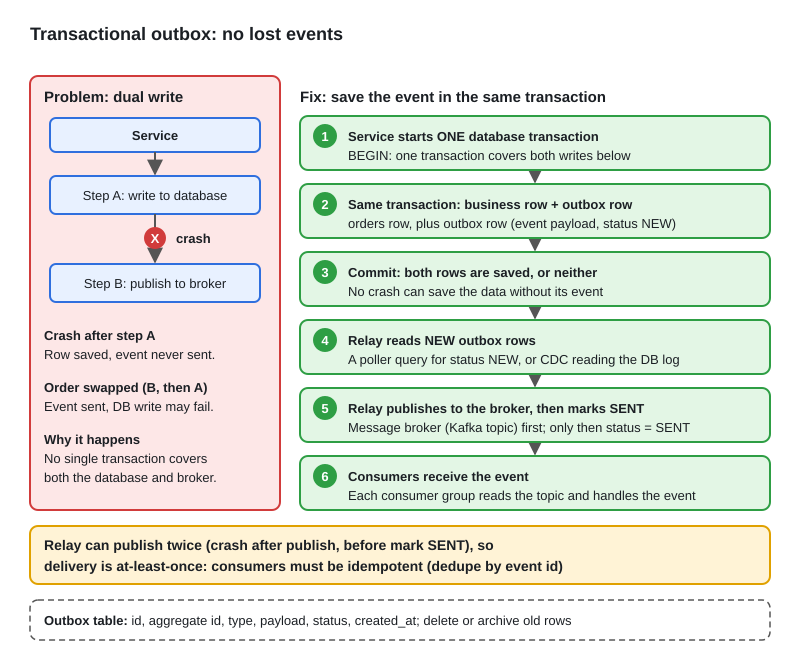
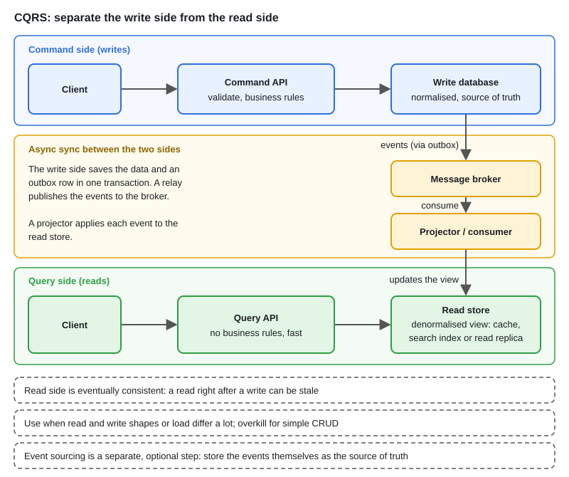
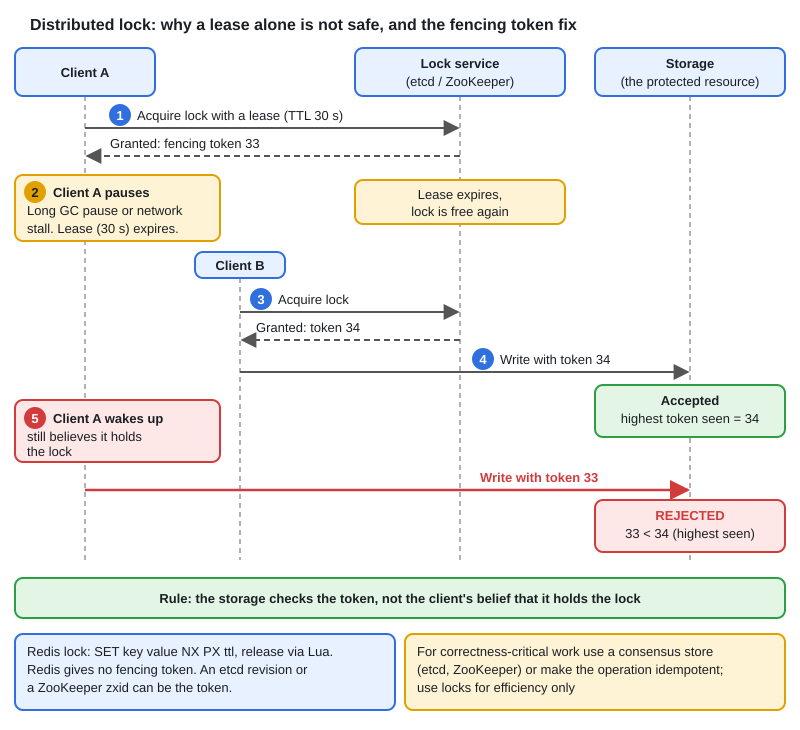

# Distributed Design Patterns

[← Section index](../README.md) · Prev: [System Design Interview Framework & Checklist](../16-system-design-interview-framework-and-checklist/README.md)

**Interview weight: 1.1%**  ·  Revise in: 12 min

## In one line
Each microservice owns its database, so there is no shared transaction: use a saga for cross-service workflows, an outbox to publish events safely, CQRS to split reads from writes, and a lease with a fencing token for "only one does this".

## Must know
- **Why patterns:** no ACID across services. Two-phase commit (2PC) locks resources across services and blocks if the coordinator dies, so it is avoided between microservices.
- **Saga:** a chain of local transactions. If a step fails, run compensating actions for the earlier steps in reverse. It is eventually consistent, and other requests can see the in-between state.
- **Orchestration vs choreography:** orchestration has a coordinator that tells each service what to do (easy to follow). Choreography has services react to each other's events (loose coupling, harder to trace).
- **Outbox:** write the business row and an event row in ONE local transaction; a relay (poller, or CDC = reading the DB log) publishes the rows. Fixes the dual-write problem (a crash between DB commit and publish loses the event). Delivery is at-least-once, so consumers must be idempotent.
- **Idempotent consumer:** dedupe by event id or an idempotency key (see topic 06).
- **CQRS:** separate the write model from the read model; events update the read store. Reads can be stale. Use it when read and write shapes or load differ, not for simple CRUD. Event sourcing (store events as the source of truth) is optional and adds a lot of complexity.
- **Distributed lock:** Redis `SET key value NX PX ttl` (a lease: the lock expires by itself), release only if the value still matches. A holder can pause past expiry, so the resource checks a fencing token: a number that grows with each grant, and older numbers are rejected. Redis does not issue one; etcd revisions or ZooKeeper zxids can.
- **Leader election:** one active instance (scheduler, singleton consumer) holds a lease in etcd, Consul, a Kubernetes Lease or a DB row; others wait and take over when it expires. The same fencing idea protects against a stale leader.
- **API gateway and BFF:** one entry point for auth, rate limit and routing; a backend-for-frontend per client type. Service discovery in Kubernetes is DNS plus Services.
- Already covered elsewhere: retry, circuit breaker, bulkhead (06), consistent hashing (08), rate limiter (09).

## Diagram








## Code to remember
```go
type Step struct{ Do, Undo func(ctx context.Context) error }

func runSaga(ctx context.Context, steps []Step) error {
	for i, s := range steps {
		if err := s.Do(ctx); err != nil {
			for j := i - 1; j >= 0; j-- {
				_ = steps[j].Undo(ctx) // idempotent; retry or alert if it fails
			}
			return err
		}
	}
	return nil
}
```

## Common traps
- Writing to the database and publishing to the broker as two separate steps (dual write).
- Compensations that are not idempotent, or that are never retried.
- Treating a Redis lock as perfectly safe: a paused client can still write after its lease expired.
- Using CQRS or event sourcing for a simple CRUD service.
- Assuming a saga is isolated like a transaction. It is not.

## Interview Q&A

**Q1. Saga versus two-phase commit?**

**A:** 2PC gives atomicity with locks held across services and blocks if the coordinator fails, so it hurts availability. A saga commits locally at each step and undoes with compensations, so it stays available but is only eventually consistent.

**Q2. Orchestration or choreography?**

**A:** Orchestration for longer workflows with clear ordering and error handling, since one place holds the logic. Choreography for a few services with simple reactions, but the flow is harder to see and debug.

**Q3. What problem does the outbox solve?**

**A:** Saving data and publishing an event are two systems, so a crash between them loses one. The outbox writes both rows in one database transaction, and a relay publishes later. The event may be published twice, so consumers dedupe.

**Q4. Is a Redis lock safe for correctness?**

**A:** Not on its own. A client can pause, lose its lease, and still write. Use a fencing token that the resource checks, or a consensus store such as etcd, or make the operation idempotent. Use simple locks for efficiency only.

**Q5. When would you use CQRS, and what do you give up?**

**A:** When reads and writes need different models or scale, for example a heavy search view over simple writes. You give up immediate consistency and take on more moving parts.

**Q6. How do you build an idempotent consumer?**

**A:** Store the processed event id in the same transaction as the side effect, with a unique constraint, and skip duplicates. For external calls, pass the event id as the idempotency key.

**Q7. How does leader election work, and what can go wrong?**

**A:** Instances compete for a lease in etcd, a Kubernetes Lease or a DB row, and the winner keeps renewing it. A paused leader can wake up after losing the lease and still act, so guard writes with a fencing token.
