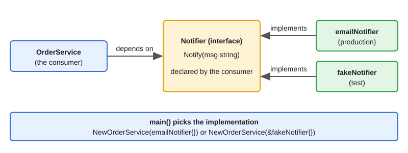

# SOLID Principles in Go

[← Section index](../README.md) · Next: [Creational Patterns in Go](../02-creational-patterns/README.md)

**Interview weight: 1.2%**  ·  Revise in: 10 min  ·  Run: `go run ./06-lld-design-patterns/01-solid-principles-in-go`

## In one line
In Go, SOLID mostly means small interfaces owned by the consumer, concrete types returned from constructors, and dependencies passed in.

## Must know
- **S**: one reason to change per type or package. Split pricing, storage and notification.
- **O**: add behaviour by adding a new type that satisfies an interface, not by editing a switch.
- **L**: any implementation must honour the interface contract (no surprise panics, no stricter inputs).
- **I**: prefer 1-3 method interfaces. `io.Reader` and `io.Writer` are the model.
- **D**: depend on an interface, receive it in the constructor, wire it in `main()`.
- "Accept interfaces, return structs." Define the interface where it is used, not where it is implemented.
- No inheritance in Go. Reuse code with composition (struct embedding) and interfaces.
- Interfaces are satisfied implicitly, so a fake in a test needs no registration.

## Diagram


## Code to remember
```go
type Notifier interface{ Notify(msg string) }

type OrderService struct{ notifier Notifier }

func NewOrderService(n Notifier) *OrderService { return &OrderService{notifier: n} }
// prod: NewOrderService(emailNotifier{})   test: NewOrderService(&fakeNotifier{})
```

## Common traps
- Big "god" interfaces with 8+ methods. Fakes become painful. Split them.
- Defining an interface for every struct "just in case". Add one when a second implementation or a test needs it.
- Returning an interface from a constructor, which hides the concrete type for no gain.
- Using embedding to fake inheritance. Embedding promotes methods but there is no is-a or virtual dispatch.

## Interview Q&A

**Q1. How do you apply the open/closed principle in Go?**

**A:** Put the varying behaviour behind an interface (discount, notifier, pricing). A new rule is a new type, and the caller does not change.

**Q2. Where should an interface be declared?**

**A:** In the package that consumes it. The producer returns a concrete struct, and the consumer declares only the methods it needs.

**Q3. How do you do dependency injection without a framework?**

**A:** Constructor functions take interfaces, and `main()` (the composition root) builds and passes them. Tests pass fakes.

**Q4. Give a Liskov violation in Go.**

**A:** A `Writer` implementation whose `Write` panics or silently drops data for some inputs. Callers relying on the interface contract break.

**Q5. Composition vs inheritance in Go?**

**A:** Go has no inheritance. Embed a type to reuse its methods, or hold it as a field and delegate. Both are composition.

**Q6. Single responsibility: give a Go example.**

**A:** `OrderService` computes totals, `OrderRepo` stores orders, `Notifier` sends mail. Each has one reason to change, so a new DB touches only the repo.

**Q7. Interface segregation: give a Go example.**

**A:** A function that only reads takes `io.Reader`, not `io.ReadWriteCloser`. Callers and fakes then implement one method, not three.
