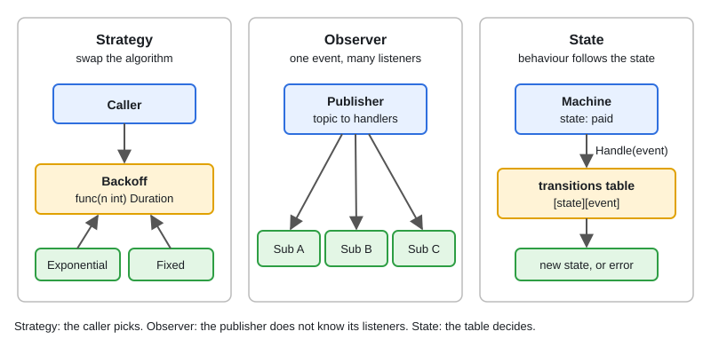

# 04 · Behavioral Patterns in Go

[← Section index](../README.md) · Prev: [03 · Structural Patterns in Go](../03-structural-patterns/README.md) · Next: [Idiomatic Go Architecture Patterns](../05-idiomatic-go-architecture-patterns/README.md)

**Interview weight: 0.9%**  ·  Revise in: 8 min  ·  Run: `go run ./06-lld-design-patterns/04-behavioral-patterns`

## In one line
Strategy is a func or interface you swap, observer is a topic-to-handlers map, and state is a transition table.

## Must know
- **Strategy**: pick an algorithm at runtime (retry backoff, pricing). A func type or a one-method interface.
- **Observer**: the publisher calls subscribers and does not know who they are.
- **State**: a missing key in `map[State]map[Event]State` is an illegal transition.
- Use state objects (an interface per state) only when each state has real behaviour.
- A synchronous observer is the simplest. For slow subscribers use goroutines or buffered channels.
- Guard the subscriber map with `sync.RWMutex` if Subscribe and Publish can run concurrently.
- Name the pattern in the interview, then show the small Go version.

## Diagram


## Code to remember
```go
type Backoff func(attempt int) time.Duration

func Exponential(base time.Duration) Backoff {
	return func(n int) time.Duration { return base << n }
}

var next = map[State]map[Event]State{"created": {"pay": "paid"}, "paid": {"ship": "shipped"}}
```

## Common traps
- Calling subscriber handlers while holding the mutex. A slow or re-entrant handler then deadlocks you.
- A panicking subscriber taking down the publisher in a synchronous bus.
- Giant `switch` state machines scattered across methods. Keep one table as the source of truth.
- Leaking goroutines in an async observer with no way to unsubscribe or stop.

## Interview Q&A

**Q1. Strategy vs if/else?**

**A:** Strategy lets callers or config choose the algorithm without changing the driver code. If/else is fine for two fixed branches.

**Q2. How do you make an observer thread-safe?**

**A:** `sync.RWMutex` around the map. Copy the handler slice under the lock, then call handlers after unlocking.

**Q3. Table-driven state machine or state objects?**

**A:** Table when transitions are the logic, objects when each state carries its own behaviour.

**Q4. How do you stop a slow subscriber blocking the publisher?**

**A:** Give each subscriber a buffered channel and its own goroutine, and decide a policy when full (drop or block).

**Q5. Where does Go's channel fit the observer pattern?**

**A:** A channel per subscriber is a built-in way to fan events out, with `select` and context for shutdown.

**Q6. Strategy as a func type or an interface?**

**A:** A func type when it is one stateless operation (`Backoff`). An interface when the strategy has state or several methods.
